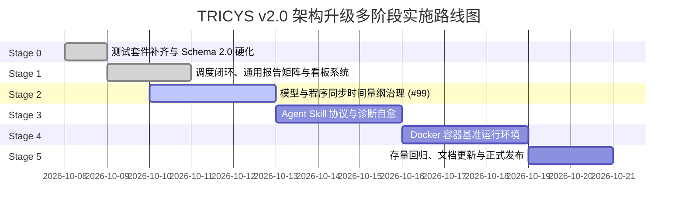
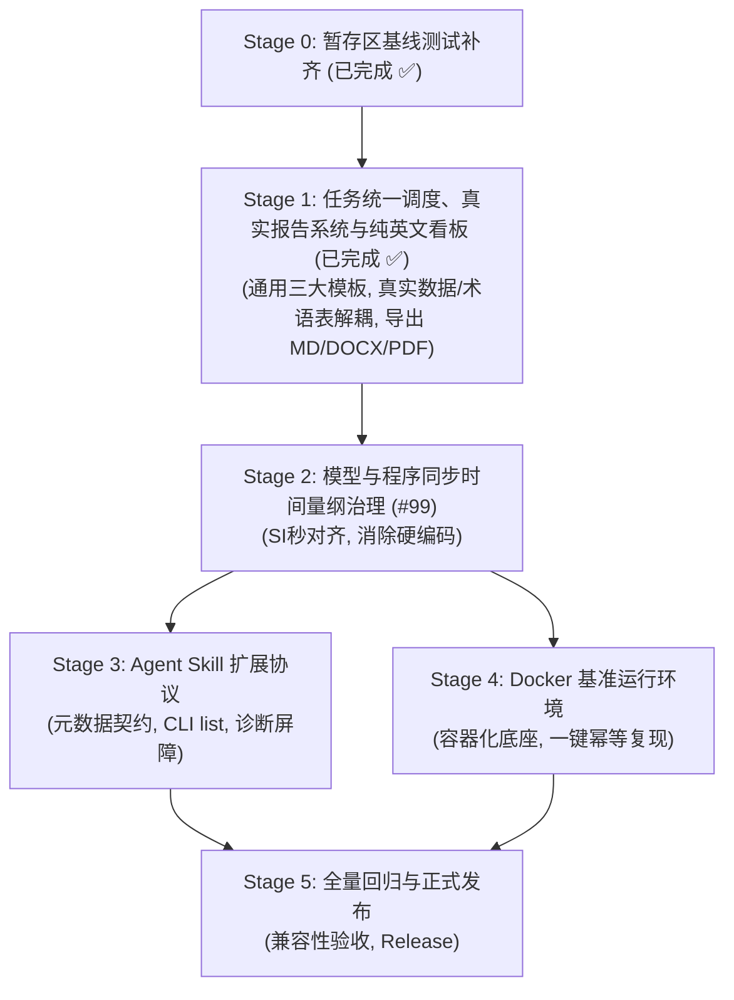

# TRICYS v2.0 架构升级多阶段实施路线与开发计划

> **文档版本**: v1.3.0  
> **更新时间**: 2026-10-10  
> **文档定位**: 依据 [`V2_RFC.md`](./V2_RFC.md) 架构规范与最新指导要求，制定系统性实施路线。**Stage 0（Schema 2.0 基础）与 Stage 1（任务统一调度、并发解耦、三大通用工程报告模板、术语表解耦、纯英文现代 Visualizer 看板及多格式导出）已全面高标准交付**。

---

## 📌 目录 (Table of Contents)

1. [项目背景与现状审计 (Current State Audit)](#1-项目背景与现状审计)
   - [1.1 RFC 核心架构支柱与目标](#11-rfc-核心架构支柱与目标)
   - [1.2 暂存区与当前完成工作盘点 (Stage 0 & Stage 1 全面交付)](#12-暂存区与当前完成工作盘点)
   - [1.3 差距分析与实施战略聚焦](#13-差距分析与实施战略聚焦)
2. [多阶段演化全景与里程碑 (Evolution Roadmap)](#2-多阶段演化全景与里程碑)
3. [各阶段详细设计、需求与验收标准](#3-各阶段详细设计需求与验收标准)
   - [Stage 0: 暂存区基线测试补齐与 Schema 2.0 基础硬化 (已完成 ✅)](#stage-0-暂存区基线测试补齐与-schema-20-基础硬化-已完成-)
   - [Stage 1: Schema 2.0 任务统一调度、并发解耦与 Visualizer 真实报告系统 (已完成 ✅)](#stage-1-schema-20-任务统一调度并发解耦与-visualizer-内置报告导出系统-已完成-)
   - [Stage 2: 模型与程序同步的时间量纲治理与 Issue #99 彻底根除](#stage-2-模型与程序同步的时间量纲治理与-issue-99-彻底根除)
   - [Stage 3: Agent Skill 扩展协议与自愈诊断屏障](#stage-3-agent-skill-扩展协议与自愈诊断屏障)
   - [Stage 4: 云原生 Docker 基准运行环境与一键复现底座](#stage-4-云原生-docker-基准运行环境与一键复现底座)
   - [Stage 5: 全量兼容性回归、基准算例验收与 v2.0 正式交付](#stage-5-全量兼容性回归基准算例验收与-v20-正式交付)
4. [依赖矩阵与关键路径 (Dependency Matrix)](#4-依赖矩阵与关键路径)
5. [质量保障与风险防御策略 (QA & Risk Management)](#5-质量保障与风险防御策略)

---

## 1. 项目背景与现状审计

### 1.1 RFC 核心架构支柱与目标

[`V2_RFC.md`](./V2_RFC.md) 确立了 TRICYS 迈向聚变科学计算基础设施的五大核心升级方向：
1. **面向生命周期的可插拔工作流引擎**：$\text{Preprocess} \rightarrow \text{SimulationEngine} \rightarrow \text{Postprocess}$ 单向流动；后处理保持只读纯粹性；消除双层进程池死锁；二分寻优在仿真执行层受控闭环。
2. **Schema 2.0 配置规范与依赖注入**：五大支柱（`model`, `scenario`, `task`, `plugins`, `visualizer`）；任务判别联合体；算子化指标提取（`task.metrics`）；通过 `PipelineBuilder` 实现控制反转。
3. **Agent Skill 协议兼容**：外置 Python 脚本零侵入动态挂载；自描述元数据；结构化异常屏障与自修复闭环。
4. **模型时间单位治理（[Issue #99](https://github.com/asipp-neutronics/tricys/issues/99)）**：全面拥抱国际单位制“秒（SI seconds）”；FOC 双头指令解析；指标算子量纲感知与显式缩放。
5. **完备基准案例 Docker 运行环境**：基于 OpenModelica 1.24.5，实现论文基准算例一键幂等复现。

---

### 1.2 暂存区与当前完成工作盘点

当前仓库与分支已圆满完成 Stage 0 与 Stage 1 全部攻坚任务（220+ 项测试 100% 绿灯）：
- **Schema 2.0 数据结构与全配置消费**：`ModelConfig`, `ScenarioConfig`, `PulseConfig`, `TaskTypeUnion`, `MetricConfig`, `PluginsConfig`, `VisualizerConfig`, `TricysV2Config` 强类型定义及合成兼容属性全链路生效，杜绝悬空死字段。
- **任务统一多态调度与单层安全并发**：`main.py` 依据 `task.type` 多态分发，单层受控进程池消除死锁，仿真执行期二分逼近闭环。
- **三大通用任务核心报告模板矩阵**：精简收敛为 `simulate`, `sweep`, `sensitivity` 三大通用物理任务报告体系，彻底剥离冗余特定死模板。
- **报告数据 100% 真实性保障与术语表解耦**：彻底杜绝数据伪造与硬编码，动态基准识别；支持通过配置加载外部 Glossary CSV 术语映射字典。
- **Visualizer 纯英文现代看板与多格式导出**：四大卡片流式工作台、纯英文 UI（中文报告正文）、自适应小边框操作工具栏；一键导出学术级 `.md`、`.docx`（LaTeX token 化与三线表）和 `.pdf`。
- **单元测试与 E2E 测试完备**：覆盖 Schema 2.0、任务分发、算子提取、Visualizer 下拉过滤、报告真实性、术语映射及多格式导出（28 项 Visualizer 专项测试全绿）。

---

### 1.3 差距分析与实施战略聚焦

Stage 0 与 Stage 1 的全面交付为后续升级筑牢了地基：
1. **后续主攻焦点 (Stage 2)**：时间量纲系统性治理（[Issue #99](https://github.com/asipp-neutronics/tricys/issues/99)），消灭全库隐式小时转换，使模型与程序完全对齐至国际单位制“秒（SI seconds）”。
2. **拓展演进 (Stage 3 & 4)**：推进 Agent Skill 元数据契约自描述、自愈诊断屏障与云原生 Docker 基准运行环境。

---

## 2. 多阶段演化全景与里程碑

---

## 3. 各阶段详细设计、需求与验收标准

### Stage 0: 暂存区基线测试补齐与 Schema 2.0 基础硬化 (已完成 ✅)

- **状态**: 100% 交付通过（38/38 测试绿灯，`ruff` 检查无错，已全部加入暂存区）。
- **包含**: [test_schema_v2.py](file:///d:/Administrator/Documents/Github/tricys/test/core/test_schema_v2.py), [test_metric_v2.py](file:///d:/Administrator/Documents/Github/tricys/test/analysis/test_metric_v2.py), [test_static_alarm.py](file:///d:/Administrator/Documents/Github/tricys/test/analysis/test_static_alarm.py), [test_baseline_analysis.py](file:///d:/Administrator/Documents/Github/tricys/test/analysis/test_baseline_analysis.py)。

---

### Stage 1: Schema 2.0 任务统一调度、并发解耦与 Visualizer 真实报告系统 (已完成 ✅)

- **状态**: 100% 交付通过（全量测试 220+ 项通过，Visualizer 28 项专项测试全绿，`ruff` 检查无错，已全部加入暂存区）。
- **包含**:
  - `tricys/visualizer/report/templates.py`: 三大通用物理任务核心报告模板与外部术语表映射
  - `tricys/visualizer/report/figures.py`: 动态真实图表生成引擎（严格真实数据驱动，无伪造）
  - `tricys/visualizer/report/exporter.py`: `.md`, `.docx`, `.pdf` 出版级多格式导出引擎
  - `tricys/visualizer/layout.py` & `callbacks.py`: 四大卡片流式工作台、纯英文 UI、双端自适应工具栏、预存与实时渲染自愈
  - `tricys/utils/config_utils.py` & `tricys/workflow/builder.py`: Schema 2.0 全字段有效注入与统一多态调度
  - `tricys/simulation/engines/standard.py` & `compiler.py`: 无死锁单层并发防护与编译参数全链路消费
  - 测试套件: `test/visualizer/test_report_export.py`, `test/visualizer/test_sweep_report_authenticity.py`, `test/visualizer/test_report_glossary.py`, `test/visualizer/test_metrics_dropdowns.py`, `test/workflow/test_task_dispatching.py`

#### 1. 阶段目标
1. 确保 Schema 2.0 的五大核心支柱及所有子配置字段在全链路中**真实消费并严格生效**，绝无冗余死字段；
2. 打通 `simulate`, `sweep`, `sensitivity`, `cosim` 四类计算任务在 `main.py` 与 `WorkflowPipeline` 中的多态分发调度，消灭双层进程池死锁；
3. 大幅升级 Visualizer 看板，**在 Web 界面原生呈现四大卡片流式现代工作台，基于三大通用核心物理任务模板构建 100% 真实数据报告，支持外部专业术语表解耦，并提供一键导出 `.md`, `.docx`, `.pdf` 报告的功能**。

#### 2. 需求清单 (Requirements)

##### (1) 全配置字段真实有效性保障 (Field Effectiveness)
- **REQ-1.1**: **`model` 字段贯通**：
  - `fileName` 与 `modelName` 接入模型编译；
  - `loadModel`（第三方库依赖，如 Modelica 4.0.0）传递至 OpenModelica 静态编译器脚本中显式加载；
  - `cflags`（如 `-O3`）与 `target`（`gcc`/`msvc`）下发至 C 构建阶段，真实控制二进制优化级别。
- **REQ-1.2**: **`scenario` 字段贯通**：
  - `stopTime`, `startTime`, `stepSize`, `numberOfIntervals`, `tolerance`, `method` 准确转化为仿真运行时命令行参数；
  - `variableFilter` 严格截断输出时序列，减轻磁盘 I/O；
  - `pulse` 触发 `FOCInjectorPlugin` 动态打桩注入。
- **REQ-1.3**: **`task` 与 `plugins` 字段贯通**：
  - 任务参数空间覆盖、高阶算子提取规则、并发数与随机数种子全部绑定至工作流执行流；
  - 显式声明的 `plugins.preprocess` 与 `plugins.postprocess` 列表根据 `PluginSpec` 参数动态装配执行。

##### (2) 任务多态分发与无死锁调度 (Unified Dispatching & Deadlock-Free)
- **REQ-1.4**: **全任务统一分发器 (Unified Task Dispatcher)**：
  在 `main.py` 中依据 `task.type` 路由：
  - `type: "simulate"`: 单点工况执行；
  - `type: "sweep"`: 离散工况 / 网格工况批量调度；
  - `type: "sensitivity"`: 调度 `SimulationSetupPlugin`（Sobol/LHS 抽样）+ 批量计算 + `SensitivityAnalysisPlugin`（方差分解）；
  - `type: "cosim"`: 降级为单线程顺序协作仿真。
- **REQ-1.5**: **消解双层进程池死锁策略**：
  在多工况扫参及敏感性批量执行时，严格设置每个子作业仿真执行为 `max_workers = 1`，将并发完全控制在外层单级进程池，杜绝 IPC 管道耗尽。
- **REQ-1.6**: **受控二分逼近寻优闭环**：
  加固 `StandardSimulationEngine` 中的 `BisectionOptimizer`，在仿真执行期基于预编译二进制受控迭代收敛，后处理只读提取结果。

##### (3) 三大通用任务核心报告体系与真实性保障 (Universal Core Templates & Authenticity)
- **REQ-1.7**: **三大通用核心物理任务模板 (Universal Core Physics Templates)**：
  废弃针对具体个例硬编码的冗余模板，收敛为涵盖聚变计算的三大通用物理任务报告体系，依据 `task.type` 智能匹配：
  1. **`simulate` 专属**：**《氚燃料循环单工况动态仿真工程报告》(Dynamic Simulation Report)**：
     - 单堆脉冲动态响应分析、全厂时序质量守恒相对残差审计表（$<10^{-3}$ 判定）、工艺子组件滞留量演化。
  2. **`sweep` 专属**：**《氚燃料循环多工况参数扫描工程报告》(Parameter Sweep Report)**：
     - 真实参数空间覆盖与离散取样统计、实际执行对比工况设定清单；
     - 完整横向多工况核心性能指标 (KPI) 定量对比表（参数列与指标列全动态展开，真实数据填充）；
     - 真实图表集：核心性能指标多工况对比柱状图、关键子系统铺底与储罐联动演化双子图、谷底准入条件对比图（数据存在时动态绘制）。
  3. **`sensitivity` 专属**：**《氚燃料循环全局敏感性分析工程报告》(Global Sensitivity Report)**：
     - 输入参数不确定性空间表、Sobol 一阶主效应与全阶敏感度指数分解表、参数交互作用度测定与重要度工程评级。
- **REQ-1.8**: **数据 100% 真实性审查与防伪造机制 (Strict Authenticity Guarantee)**：
  - 严禁在模板中写死虚构数值、假基准或伪造图表。
  - **动态基准工况判定**：严格依据 `baseline` 字段或首个工况动态提取基准值；若未显式指定基准工况，则严谨展示“样本均值 (Mean)”，杜绝武断标记；
  - **动态指标全量呈现**：所有指标、事实依据与统计结论必须 100% 源自实际仿真或指标算子输出，缺失时如实呈现。
- **REQ-1.9**: **外部专业术语表解耦 (External Glossary Mapping)**：
  - 杜绝在代码库中硬编码专业参数与术语的中英文映射；
  - 报告生成引擎通过 `load_glossary_mapping` 支持配置文件中指定外部专业术语字典（如 `glossary.csv`）；
  - 配置外部字典时，自动在报告表格、参数说明与图表坐标轴上完成中英文与工程含义映射；未指定时优雅保持原参数名称。

##### (4) Visualizer 四大卡片工作台、纯英文 UI 与多格式导出 (Visualizer 4-Section Workbench & Export)
- **REQ-1.10**: **四大卡片流式现代工作台 (Four-Section Card Workbench)**：
  - **Section 1: Run Details (Config & Logs)**：工况配置总览、运行上下文与模拟日志；
  - **Section 2: Select Simulation Jobs**：双端自适应紧凑工具栏。左侧（全选复选框 + Apply 按钮）自适应小卡片，垂直对齐与上下间距协调；右侧（Clear / Batch CSV / Wide CSV）精简小边框操作组，自适应贴合右侧，消灭半屏空白冗余边框；
  - **Section 3: Plot Results & Key Metrics**：动态时序演化、指标筛选比对、高维参数交互探索；
  - **Section 4: Engineering Report Hub (Multi-Format Export)**：内嵌式工程报告中心，顶部控制条呈现 Dedicated 徽章、当前报告标题、磁盘同步/实时渲染状态与刷新按钮。
- **REQ-1.11**: **看板纯英文 UI 国际化 (English UI & Chinese Technical Report)**：
  - Visualizer 界面所有卡片标题、操作按钮、提示标签、状态指示器及占位符**默认全部采用纯英文**；
  - 报告正文（Markdown 预览及导出文件）保持规范严谨的**专业中文工程技术报告**。
- **REQ-1.12**: **出版级多格式一键导出引擎 (Multi-Format Export: MD, DOCX, PDF)**：
  - **Markdown (`.md`)**：导出带自包含 Base64 高清图表引用的标准化学术 Markdown；
  - **Word (`.docx`)**：专业 Navy/Slate 色系排版引擎，支持 LaTeX 数学公式 Token 化、斑马纹高品质三线表及居中图注；
  - **PDF (`.pdf`)**：利用 `PyMuPDF` 矢量渲染引擎，输出期刊/工程交付品质的完整 PDF 报告。

#### 3. 关键任务与影响文件 (WBS & Scope)
- 改造 [tricys/main.py](file:///d:/Administrator/Documents/Github/tricys/tricys/main.py)：实现基于 `task.type` 的统一任务多态分发
- 强化 [tricys/workflow/builder.py](file:///d:/Administrator/Documents/Github/tricys/tricys/workflow/builder.py)：打通所有配置字段注入（`cflags`, `loadModel`, `variableFilter`, `plugins` 等）
- 加固 [tricys/simulation/engines/standard.py](file:///d:/Administrator/Documents/Github/tricys/tricys/simulation/engines/standard.py)：严格单层并发限制与 Worker 内二分寻优闭环
- 新建 [tricys/analysis/tritium_cycle.py](file:///d:/Administrator/Documents/Github/tricys/tricys/analysis/tritium_cycle.py)：实现聚变物理参数推导与自持评价算法
- 重构 [tricys/visualizer/report/templates.py](file:///d:/Administrator/Documents/Github/tricys/tricys/visualizer/report/templates.py)：实现三大通用任务核心模板、真实性防伪造逻辑与外部 Glossary 术语表挂载
- 升级 [tricys/visualizer/report/figures.py](file:///d:/Administrator/Documents/Github/tricys/tricys/visualizer/report/figures.py)：实现多工况指标柱状图、铺底与储罐联动演化双子图等真实动态绘图
- 重构 [tricys/visualizer/report/exporter.py](file:///d:/Administrator/Documents/Github/tricys/tricys/visualizer/report/exporter.py)：实现 LaTeX token 化、斑马纹三线表及高保真多格式导出
- 升级 [tricys/visualizer/layout.py](file:///d:/Administrator/Documents/Github/tricys/tricys/visualizer/layout.py)、[callbacks.py](file:///d:/Administrator/Documents/Github/tricys/tricys/visualizer/callbacks.py) 与 [tricys_dash_theme.css](file:///d:/Administrator/Documents/Github/tricys/tricys/visualizer/assets/tricys_dash_theme.css)：实现四大卡片流式工作台、纯英文 UI、双端自适应紧凑工具栏与多格式导出交互
- 完备测试套件：
  - `test/workflow/test_task_dispatching.py`（任务分发与并发无死锁测试）
  - `test/visualizer/test_report_export.py`（报告模板渲染与 MD/DOCX/PDF 导出测试）
  - `test/visualizer/test_sweep_report_authenticity.py`（扫参报告数据真实性、真实基准与动态图表测试）
  - `test/visualizer/test_report_glossary.py`（专业术语字典外部 CSV 挂载与未挂载回退测试）
  - `test/visualizer/test_metrics_dropdowns.py`（指标下拉框严格过滤与非数值剔除测试）
  - `test/visualizer/test_web_visualizer_cases.py`（Playwright 网页端全工况端到端自动化测试）

#### 4. 验收标准 (Acceptance Criteria)
- [x] 运行 `tricys run -c v2_examples/sensitivity_sobol.yaml`，从 Sobol 抽样、多进程执行到方差分解、图表生成与敏感性报告产出全链路跑通。
- [x] 运行 `tricys run -c v2_examples/sweep_bisection.yaml`，TBR 二分搜索在仿真期闭环完成，后处理阶段无反向外部子进程拉起。
- [x] 启动 `tricys visualize`，Web 看板中能够清晰呈现四大卡片工作台与纯英文 UI，通用工程模板正常渲染，内容包括真实参数空间、全工况 KPI 表、真实时序与物料平衡。
- [x] 真实性自检通过：扫参报告中严禁虚构数据，基准工况无标注时严谨回退为样本均值，无谷底时优雅跳过谷底图，全量指标 100% 动态读取。
- [x] 术语字典解耦验证：挂载外部 glossary 字典后，报告表头及图表自适应中英文与工程含义；未配置时无缝回退为原参数名。
- [x] 界面协调性微调完成：工具栏左侧与右侧外边框自适应紧凑贴合，Clear/Batch CSV/Wide CSV 外边框缩小，按钮边框细致，上下间距与垂直居中协调。
- [x] 在 Web 界面点击或调用导出接口，能够成功生成并下载符合排版标准的 `.md`、`.docx`（含 LaTeX 公式与斑马纹三线表）和 `.pdf` 报告文件，文件体积与内容完整无乱码。
- [x] 真实工况自动化验证：通过 Playwright 自动化测试套件在扫参、Sobol 敏感性及脉冲工况全量通过端到端交互测试并保存高清运行截图。
- [x] 压力测试：在高并发多工况任务下，系统平稳运行，单层进程池安全限制，无 IPC 死锁、无僵尸子进程。

---

### Stage 2: 模型与程序同步的时间量纲治理与 Issue #99 彻底根除

#### 1. 阶段目标
在调度与任务引擎运行稳定的前提下，与物理模型全面同步切换为国际单位制“秒（SI seconds）”，彻底消灭代码库中历史遗留的“小时制”隐式魔法假设，打通 `.foc` 输入、`scenario` 积分、指标算子提取与图表展示的全链路量纲自洽。

#### 2. 需求清单 (Requirements)
- **REQ-2.1**: **后处理量纲解耦与显式转换**：
  重构 `tricys/analysis/baseline_analysis.py` 与 `tricys/analysis/metric.py`，移除 `doubling_time / 24` 等硬编码计算，改由 `conversion_factor` 显式驱动（秒转天：`86400.0`，秒转年：`31536000.0`）。
- **REQ-2.2**: **指标提取器量纲感知 (Unit-Aware Metric Extractor)**：
  在 `SimulationStoragePlugin` 中计算特征指标时，严格以输入数据的秒时间戳为计算基准，并在写入 HDF5/CSV 时保留原单位与换算后单位属性。
- **REQ-2.3**: **FOC 预处理时间解析加固**：
  确保 `FOCInjectorPlugin` 能够无歧义识别 `TIME_UNIT second` 与 `TIME_UNIT hour`（带 `TIME_CONVERSION hour_to_second`），并断言输出脉冲表的时间轴严格对齐到秒。
- **REQ-2.4**: **图表标签与报表表头自适应**：
  报告与制图模块（`tricys/analysis/report.py`）根据指标配置中的 `unit` 动态渲染坐标轴与单位标签，彻底杜绝“实际是秒但轴标签写着小时”的严重误导。

#### 3. 关键任务与影响文件 (WBS & Scope)
- 改造 [tricys/analysis/metric.py](file:///d:/Administrator/Documents/Github/tricys/tricys/analysis/metric.py) 支持量纲因子
- 消除 [tricys/analysis/baseline_analysis.py](file:///d:/Administrator/Documents/Github/tricys/tricys/analysis/baseline_analysis.py) 中 `doubling_time / 24` 硬编码
- 加固 [tricys/core/foc.py](file:///d:/Administrator/Documents/Github/tricys/tricys/core/foc.py) 及预处理器
- 编写专属回归测试 `test/core/test_time_unit_governance.py`

#### 4. 验收标准 (Acceptance Criteria)
- [ ] 给定 `stopTime: 86400.0`（1 天），倍增时间计算结果在 `unit="day"` 时精准等于 `doubling_time_in_seconds / 86400.0`。
- [ ] 针对 Issue #99 编写的对比用例，原先产生 3600 倍失真的倍增时间与拐点时间恢复为准确理论值。
- [ ] 全量代码库使用 `git grep " / 24"` 与 `git grep " / 8760"` 检查，确认无任何隐式除法转换残留。

---

### Stage 3: Agent Skill 扩展协议与自愈诊断屏障

#### 1. 阶段目标
为 AI Coding Agent（如 Google Antigravity、Claude Code、Cursor）提供标准化的协议接口，实现插件零侵入自描述热插拔，以及仿真异常的结构化自修复反馈。

#### 2. 需求清单 (Requirements)
- **REQ-3.1**: **插件元数据自描述契约 (Plugin Metadata Contract)**：
  在 `BasePlugin` 中确立 `get_metadata() -> PluginMetadata` 契约，包含 `name`, `version`, `category` (preprocess/engine/postprocess), `input_requirements`, `output_artifacts`, `parameter_schema`。
- **REQ-3.2**: **Agent 专用 CLI 查询命令**：
  实现 `tricys plugin list --json` 与 `tricys plugin info <name> --json`，供 Agent 单次查询当前已注册插件的全量能力与参数规范。
- **REQ-3.3**: **外置 Agent 脚本动态加载安全屏障**：
  增强 `PluginRegistry.load_class_from_source`，当 Agent 在工作区指定自定义 `script: "./custom_plugin.py"` 时，执行动态加载、基类契约签名检查与安全沙箱告警。
- **REQ-3.4**: **结构化异常屏障与自修复反馈协议 (Self-Correction Protocol)**：
  捕获 Modelica 编译语法错误、C 运行期内存溢出、数值发散、质量不守恒等故障，输出标准化 JSON 错误摘要（含 `error_type`, `root_cause`, `context_snapshot`, `suggested_fix`），直接作为 Tool Result 反馈给 Agent。

#### 3. 关键任务与影响文件 (WBS & Scope)
- 改造 [tricys/workflow/base.py](file:///d:/Administrator/Documents/Github/tricys/tricys/workflow/base.py) 增加元数据规范
- 在 [tricys/workflow/registry.py](file:///d:/Administrator/Documents/Github/tricys/tricys/workflow/registry.py) 增强自描述字典提取
- 在 [tricys/main.py](file:///d:/Administrator/Documents/Github/tricys/tricys/main.py) 增加 `plugin list` 子命令
- 新建异常屏障与诊断模块 `tricys/core/diagnostics.py`
- 编写 Agent Skill 集成测试 `test/workflow/test_agent_skill.py`

#### 4. 验收标准 (Acceptance Criteria)
- [ ] 终端执行 `python -m tricys.main plugin list --json`，能够返回合法 JSON，完整展示系统中已注册的全部插件名与输入输出契约。
- [ ] 提供一个存在 Modelica 语法错误的模型，框架能够拦截并返回包含定位与修改建议的结构化 JSON 诊断信息。
- [ ] 动态加载测试用例：在外部目录新建一个继承自 `PostprocessPlugin` 的脚本并配置到 yaml 中，Pipeline 能够正确加载、实例化并执行该脚本。

---

### Stage 4: 云原生 Docker 基准运行环境与一键复现底座

#### 1. 阶段目标
构建开箱即用的 Docker 容器化底座，实现跨平台（Windows/Linux/macOS）与 HPC 集群上“零环境配置、单命令幂等复现”全部基准案例。

#### 2. 需求清单 (Requirements)
- **REQ-4.1**: **轻量化科学仿真基底镜像**：
  编写多阶段 Dockerfile，基于 `openmodelica:v1.24.5-ompython`，集成 GCC、Make、libhdf5、Modelica 4.0 标准库预编译缓存及中英文学术绘图字体。
- **REQ-4.2**: **TRICYS v2.0 运行镜像**：
  安装 Python 3.10+、SALib、FMPy、OMSimulator 及以 editable 模式安装的 TRICYS v2.0，内置 `v2_examples` 基准算例集。
- **REQ-4.3**: **一键复现基准脚本与验证工具**：
  编写 `scripts/run_benchmarks.sh` / `scripts/run_benchmarks.py`，能够一键执行所有 `v2_examples` 并对生成产物（HDF5 / Summary CSV / 论文图表）执行哈希与物理指标容差校验。
- **REQ-4.4**: **docker-compose 本地与 Web 看板编排**：
  提供 `docker-compose.yml`，支持一键拉起后端仿真和 `tricys_visual` 前端看板。

#### 3. 关键任务与影响文件 (WBS & Scope)
- 编写 `docker/Dockerfile`
- 编写 `docker/docker-compose.yml`
- 编写 `docker/benchmark_runner.py`
- 编写基准复现文档 `docs/guides/docker_quickstart.md`

#### 4. 验收标准 (Acceptance Criteria)
- [ ] 执行 `docker build -t tricys:2.0 -f docker/Dockerfile .` 构建成功且镜像体积优化受控。
- [ ] 执行 `docker run --rm -v $(pwd)/output:/workspace/output tricys:2.0 python -m tricys.main run -c /tricys/example/example_data/v2_examples/sweep_cases.yaml`，能够 100% 成功生成 `sweep_results.h5` 与 `simulation_result.csv`。
- [ ] 基准验证脚本对基准案例结果的数值相对偏差 $\le 10^{-5}$。

---

### Stage 5: 全量兼容性回归、基准算例验收与 v2.0 正式交付

#### 1. 阶段目标
保障 v1.0 存量模型、存量配置和历史测试 100% 向后兼容无损运行；完善多语言文档与发布物，完成 v2.0 正式交付。

#### 2. 需求清单 (Requirements)
- **REQ-5.1**: **v1.0 存量用例无损兼容回归**：
  运行全部历史测试套件（`test/` 目录下所有原有测试），确保未引入任何 breaking change。
- **REQ-5.2**: **文档体系全面同步**：
  更新中英文文档（`docs/zh/` 与 `docs/en/`），纳入 Schema 2.0 配置规范手册、可插拔插件开发指南、Agent Skill 交互协议及 Issue #99 升级说明。
- **REQ-5.3**: **正式 Release 打包与变更日志**：
  更新 `pyproject.toml` 版本至 `2.0.0`，编写 `CHANGELOG.md` 与发布 Release Notes。

#### 3. 关键任务与影响文件 (WBS & Scope)
- 跑通全量测试套件并修复边缘兼容问题
- 更新 [docs/zh/](file:///d:/Administrator/Documents/Github/tricys/docs/zh/) 与 [docs/en/](file:///d:/Administrator/Documents/Github/tricys/docs/en/)
- 更新 `pyproject.toml`
- 编写 Release Notes

#### 4. 验收标准 (Acceptance Criteria)
- [ ] `pytest test/` 全量单元与集成测试绿灯通过率 100%。
- [ ] 现存所有 v1.0 JSON 配置文件无需做任何人工修改，即可被 `tricys` CLI 正常解析并准确计算。
- [ ] 研发团队依据文档能够在 5 分钟内完成一个外置动态插件的编写与装配。

---

## 4. 依赖矩阵与关键路径

- **关键路径 (Critical Path)**: `Stage 0` (完成 ✅) $\rightarrow$ `Stage 1` (完成 ✅) $\rightarrow$ `Stage 2` (量纲治理，当前主攻) $\rightarrow$ `Stage 5` (发布)
- **并行支持路径**: `Stage 3` (Agent 协议) 与 `Stage 4` (Docker 环境) 可在 `Stage 2` 量纲治理完成后并行开发。

---

## 5. 质量保障与风险防御策略

| 风险项 | 潜在影响 | 防范与缓解策略 | 监控与检测指标 |
| :--- | :--- | :--- | :--- |
| **配置字段悬空失效** | 用户配置了 `cflags`/`variableFilter` 但底层未生效 | 在 Stage 1 编写白盒配置传递校验测试，断言参数到达 OpenModelica 与执行层。 | 参数下发单测覆盖 (已通过 ✅) |
| **多进程 IPC 资源枯竭** | 高维网格扫参导致系统崩溃或死锁 | 强制内层仿真 Worker 单核运行，通过 `get_safe_max_workers()` 实施防过载保护。 | 压力测试进程数监控 (已通过 ✅) |
| **报告导出格式依赖缺失** | 导出 DOCX 或 PDF 时缺少外部依赖或字体报错 | `python-docx` 作为标准依赖；PDF 导出提供轻量 HTML2PDF 回退方案，并内置常用学术字体。 | 多格式导出端到端测试 (已通过 ✅) |
| **报告数据失真与伪造风险** | 报告模板胡编乱造、写死假数据或虚假基准 | 建立严格的真实性防伪自检，无基准时回退样本均值，无谷底时跳过图表，100% 动态读取。 | 真实性专项测试覆盖 (已通过 ✅) |
| **量纲改造破坏历史计算** | 历史小时制模型计算结果突变 | 依靠 `.foc` 的 `TIME_CONVERSION` 机制与 `unit` 兼容适配器；老配置缺少单位时提供显式 Deprecation 警告。 | 双模式对比单测 (Stage 2 推进) |
| **外部插件安全隐患** | Agent 动态脚本执行恶意或非法代码 | `PluginRegistry` 强制校验基类继承关系，限制动态加载文件权限。 | 接口合规性白盒校验 |
| **Docker 镜像过大** | 构建慢、拉取困难 | 采用多阶段构建，剥离 GCC 编译临时产物，仅保留 Python 运行时环境与编译缓存。 | 最终镜像体积 $< 2.5\text{GB}$ |

---

> **结语**：本规划中 Stage 0 与 Stage 1 已圆满达成最高质量闭环，不仅实现了 Schema 2.0 任务多态调度无死锁与全链路配置生效，更重构落地了三大通用核心工程报告体系、外部术语表映射、100% 真实数据防伪校验，以及纯英文卡片流看板与多格式导出。系统已具备向 Stage 2（时间量纲治理，Issue #99）全面攻坚的技术底座。
