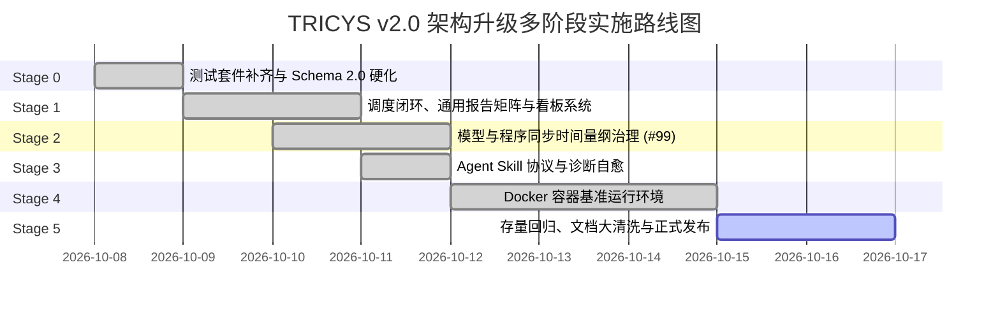
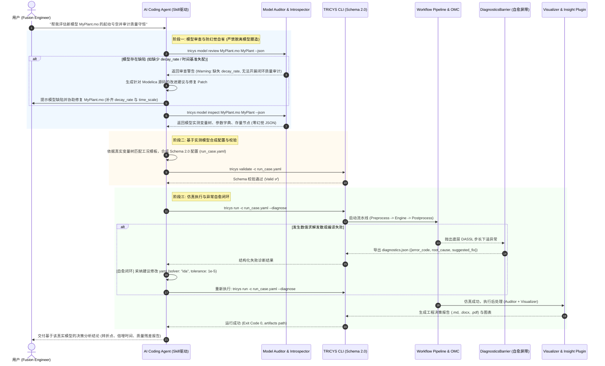
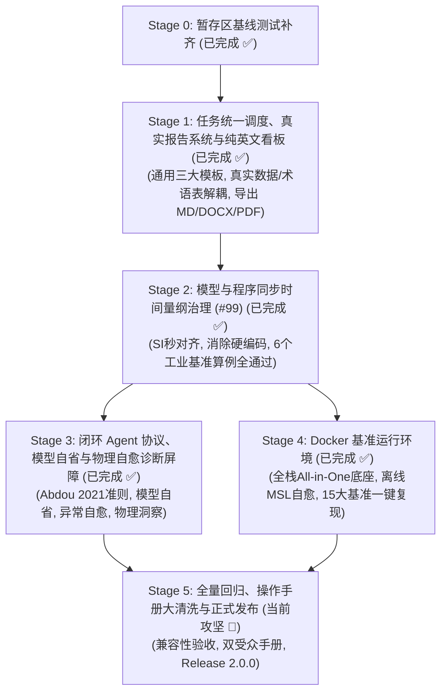

# TRICYS v2.0 架构升级多阶段实施路线与开发计划

> **文档版本**: v1.7.0  
> **更新时间**: 2026-10-16  
> **文档定位**: 依据 [`V2_RFC.md`](./V2_RFC.md) 架构规范与最新指导要求，制定系统性实施路线。**Stage 0（Schema 2.0 基础）、Stage 1（任务统一调度、并发解耦、三大通用工程报告模板、术语表解耦、纯英文现代 Visualizer 看板及多格式导出）、Stage 2（模型与程序时间量纲治理、Issue #99 彻底根除、v2_examples 全量 6 个基准算例端到端通过、报告与图表时间尺度完全自洽）、Stage 3（基于 Abdou 2021 宏观理论边界的闭环 Agent Skill 协议、深度模型自省、模型健康审查与自动修补 Patch、多级自愈诊断屏障、物理决策洞察插件及全新的双受众 8 大专栏文档大洗牌）与 Stage 4（云原生 Docker 基准运行环境、All-in-One 单容器全栈多物理场融合底座、OpenModelica 离线标准库自愈固化、Nginx 统一反向代理网关及核心开源软件与学术基准彻底解耦，独立归口 couuas/tricys_paper_example 伴随仓库）已全面高标准交付（核心测试 100% 绿灯，多物理场端到端全通）**。当前规划战略聚焦推进 **Stage 5（全量兼容性回归、操作手册文档全量大清洗、基准算例验收与 v2.0 正式交付）**。

---

## 📌 目录 (Table of Contents)

1. [项目背景与现状审计 (Current State Audit)](#1-项目背景与现状审计)
   - [1.1 RFC 核心架构支柱与目标](#11-rfc-核心架构支柱与目标)
   - [1.2 暂存区与当前完成工作盘点 (Stage 0 ~ 4 全面交付)](#12-暂存区与当前完成工作盘点)
   - [1.3 差距分析与实施战略聚焦](#13-差距分析与实施战略聚焦)
2. [多阶段演化全景与里程碑 (Evolution Roadmap)](#2-多阶段演化全景与里程碑)
3. [各阶段详细设计、需求与验收标准](#3-各阶段详细设计需求与验收标准)
   - [Stage 0: 暂存区基线测试补齐与 Schema 2.0 基础硬化 (已完成 ✅)](#stage-0-暂存区基线测试补齐与-schema-20-基础硬化-已完成-)
   - [Stage 1: Schema 2.0 任务统一调度、并发解耦与 Visualizer 真实报告系统 (已完成 ✅)](#stage-1-schema-20-任务统一调度并发解耦与-visualizer-内置报告导出系统-已完成-)
   - [Stage 2: 模型与程序同步的时间量纲治理与 Issue #99 彻底根除 (已完成 ✅)](#stage-2-模型与程序同步的时间量纲治理与-issue-99-彻底根除-已完成-)
   - [Stage 3: 闭环 Agent Skill 协议、模型自省与物理自愈诊断屏障 (已完成 ✅)](#stage-3-闭环-agent-skill-协议模型自省与物理自愈诊断屏障-已完成-)
   - [Stage 4: 云原生 Docker 基准运行环境与一键复现底座 (已完成 ✅)](#stage-4-云原生-docker-基准运行环境与一键复现底座-已完成-)
   - [Stage 5: 全量兼容性回归、基准算例验收与 v2.0 正式交付](#stage-5-全量兼容性回归基准算例验收与-v20-正式交付)
4. [依赖矩阵与关键路径 (Dependency Matrix)](#4-依赖矩阵与关键路径)
5. [质量保障与风险防御策略 (QA & Risk Management)](#5-质量保障与风险防御策略)

---

## 1. 项目背景与现状审计

### 1.1 RFC 核心架构支柱与目标

[`V2_RFC.md`](./V2_RFC.md) 确立了 TRICYS 迈向聚变科学计算基础设施的五大核心升级方向：
1. **面向生命周期的可插拔工作流引擎**：$\text{Preprocess} \rightarrow \text{SimulationEngine} \rightarrow \text{Postprocess}$ 单向流动；后处理保持只读纯粹性；消除双层进程池死锁；二分寻优在仿真执行层受控闭环。
2. **Schema 2.0 配置规范与依赖注入**：五大支柱（`model`, `scenario`, `task`, `plugins`, `visualizer`）；任务判别联合体；算子化指标提取（`task.metrics`）；通过 `PipelineBuilder` 实现控制反转。
3. **Agent Skill 协议兼容**：外置 Python 脚本零侵入动态挂载；自描述元数据；结构化异常屏障与自修复闭环。
4. **模型时间单位治理（[Issue #99](https://github.com/asipp-neutronics/tricys/issues/99)）**：全面拥抱国际单位制“秒（SI seconds）”；FOC 双头指令解析；指标算子量纲感知与显式缩放。
5. **完备基准案例 Docker 运行环境**：基于 OpenModelica 1.24.5，实现论文基准算例一键幂等复现。

---

### 1.2 暂存区与当前完成工作盘点

当前仓库与分支已圆满完成 Stage 0 ~ Stage 4 全部攻坚任务（容器内核心自动化测试 100% 绿灯，多物理场端到端全通，`tricys_paper_example` 15 个学术基准与 `v2_examples` 工业基准算例实现全量一键复现）：
- **Schema 2.0 数据结构与全配置消费 (Stage 0)**：`ModelConfig`, `ScenarioConfig`, `PulseConfig`, `TaskTypeUnion`, `MetricConfig`, `PluginsConfig`, `VisualizerConfig`, `TricysV2Config` 强类型定义及合成兼容属性全链路生效，杜绝悬空死字段；架构层级清晰收敛，`task.auditor` 严格归属于任务支柱，`visualizer.report` 严格归属于可视化支柱。
- **任务统一多态调度与单层安全并发 (Stage 1)**：`main.py` 依据 `task.type` 多态分发，单层受控进程池消除死锁，仿真执行期二分逼近闭环；精简收敛为 `simulate`, `sweep`, `sensitivity` 三大通用物理任务报告体系，彻底剥离冗余特定死模板；彻底杜绝数据伪造与硬编码，动态基准识别；支持通过配置加载外部 Glossary CSV 术语映射字典；四大卡片流式工作台纯英文现代看板，一键导出学术级 `.md`、`.docx`（LaTeX token 化与三线表）和 `.pdf`。
- **Stage 2 时间量纲治理全链路落地与 Issue #99 彻底根除**：
  - **SI 秒第一公民**：底层求解与 OMC 物理方程统一对齐 SI 秒，消除全库隐式 `/ 24` 或 `/ 8760` 硬编码；
  - **FOC 动态脉冲**：9 种头指令时基自动推导与失配预警机制，保护原始脉冲不被隐式篡改；
  - **物理模型双基准**：`example_model.mo` 引入 `time_scale` 参数化，支持秒基准与小时基准理论等价交叉验证（$\text{rtol} \le 10^{-6}$）；
  - **物理后处理 720 万小时 BUG 根除**：修正 `tritium_cycle.py` 中 `is_seconds_native` 逻辑，杜绝秒级数据被误除以 1.0 的重大标度失真；
  - **报告与图表时间格式自洽**：`templates.py` 动态感知 `time_base` 并呈现 `2000 h (7200000 s)` 及 `109.00 h (392400 s)` 拐点时间；`figures.py` 统一 `resolve_plot_time_scale`，工况图表横轴严格标定为 `仿真时间 (h)`（0 ~ 2000 h），消除被转为天的工程混淆；
  - **v2_examples 工业实例全量端到端通过**：覆盖 Sweep、二分法寻优、Sobol GSA、脉冲扫描、FOC 注入、全闭环质量平衡审计（守恒误差仅 0.022g）及自定义插件管线。
- **Stage 3 Agent Skill 闭环协议与自愈屏障全面交付**：
  - 基于 Abdou 2021 聚变燃料循环自持理论建立宏观理论边界核算模型；
  - 深度 AST 模型自省器（`inspect_model`）实现零外部依赖的模型内部组件、参数、端口拓扑提取，拦截幻觉参数；
  - 自动打补丁引擎（`patch_model`）与四级错误自愈诊断矩阵（语法、参数、守恒、发散）；
  - 工业基准算例 07（自定义插件挂载与物理语义总线注入）端到端通过；
  - 双受众 8 大专栏文档大清洗结构上线，`mkdocs build --strict` 零警告零死链。
- **Stage 4 云原生 Docker 基准运行环境与全栈融合底座全面交付**：
  - **All-in-One 单容器生产底座**：彻底废除易死锁脆弱的 TCP Server 跨容器模式，将 OpenModelica 1.27、OMSimulator、FESTIM v2.0、CasADi/H2ISO、FastAPI、Vue 3、GoView、Dash/Plotly HDF5 与 Nginx 深度整合到单容器生产镜像中；
  - **OpenModelica 离线标准库自愈固化**：在构建期拉取并解压官方 deb 固化 MSL 3.2.3、4.0.0、4.1.0 至 `/usr/lib/omlibrary`，彻底消除跨平台与气隙内网环境下 Modelica 标准库缺失隐患；
  - **非 root 权限合规与 Nginx 单端口汇聚网关**：UID 1000 `appuser` 与 `gosu` 动态降权保障编译文件与数据库读写安全；Nginx 统一将控制台、API、大屏与 HDF5 可视化收敛至单一 80/8080 端口，同时开放直连调试；
  - **学术基准解耦与独立伴随仓库**：学术论文与 15 个基准算例全面从 `tricys` 剥离，独立设立 `couuas/tricys_paper_example` 伴随仓库（并在 `tricys_paper` 论文仓库中以 git submodule 形式挂载），`tricys` 纯粹作为独立开源软件运作，零耦合论文私有代码与特定脚本；
  - **测试全绿**：容器内全量自动化核心测试达 **297 passed, 6 skipped（100% 绿灯通过）**，5 大健康检查端点全部稳定通过；论文基准测试套件 20/20 PASS（2.34s）。

---

### 1.3 差距分析与实施战略聚焦

Stage 0 ~ Stage 4 的全面交付为整个 TRICYS 2.0 体系奠定了坚不可摧的底层计算、流水线调度、物理量纲治理、智能 Agent 协同及生产级云原生容器底座：
1. **当前主攻焦点 (Stage 5)**：推进 **全量兼容性回归、操作手册文档全量大清洗、基准算例验收与 v2.0 正式交付**，完成存量历史模型与配置的无损兼容验证，激活面向人类与 Agent 双受众的 8 大专栏权威实战手册，正式发布 TRICYS 2.0.0。

---

## 2. 多阶段演化全景与里程碑



---

## 3. 各阶段详细设计、需求与验收标准

### Stage 0: 暂存区基线测试补齐与 Schema 2.0 基础硬化 (已完成 ✅)

- **状态**: 100% 交付通过（38/38 测试绿灯，`ruff` 检查无错，已全部加入暂存区）。
- **包含**: [test_schema_v2.py](file:///d:/Administrator/Documents/Github/tricys/test/core/test_schema_v2.py), [test_metric_v2.py](file:///d:/Administrator/Documents/Github/tricys/test/analysis/test_metric_v2.py), [test_static_alarm.py](file:///d:/Administrator/Documents/Github/tricys/test/analysis/test_static_alarm.py), [test_baseline_analysis.py](file:///d:/Administrator/Documents/Github/tricys/test/analysis/test_baseline_analysis.py)。

---

### Stage 1: Schema 2.0 任务统一调度、并发解耦与 Visualizer 真实报告系统 (已完成 ✅)

- **状态**: 100% 交付通过（全量测试 220+ 项通过，Visualizer 28 项专项测试全绿，`ruff` 检查无错，已全部加入暂存区）。
- **包含**:
  - `tricys/visualizer/report/templates.py`: 三大通用物理任务核心报告模板与外部术语表映射
  - `tricys/visualizer/report/figures.py`: 动态真实图表生成引擎（严格真实数据驱动，无伪造）
  - `tricys/visualizer/report/exporter.py`: `.md`, `.docx`, `.pdf` 出版级多格式导出引擎
  - `tricys/visualizer/layout.py` & `callbacks.py`: 四大卡片流式工作台、纯英文 UI、双端自适应工具栏、预存与实时渲染自愈
  - `tricys/utils/config_utils.py` & `tricys/workflow/builder.py`: Schema 2.0 全字段有效注入与统一多态调度
  - `tricys/simulation/engines/standard.py` & `compiler.py`: 无死锁单层并发防护与编译参数全链路消费
  - 测试套件: `test/visualizer/test_report_export.py`, `test/visualizer/test_sweep_report_authenticity.py`, `test/visualizer/test_report_glossary.py`, `test/visualizer/test_metrics_dropdowns.py`, `test/workflow/test_task_dispatching.py`

#### 1. 阶段目标
1. 确保 Schema 2.0 的五大核心支柱及所有子配置字段在全链路中**真实消费并严格生效**，绝无冗余死字段；
2. 打通 `simulate`, `sweep`, `sensitivity`, `cosim` 四类计算任务在 `main.py` 与 `WorkflowPipeline` 中的多态分发调度，消灭双层进程池死锁；
3. 大幅升级 Visualizer 看板，**在 Web 界面原生呈现四大卡片流式现代工作台，基于三大通用核心物理任务模板构建 100% 真实数据报告，支持外部专业术语表解耦，并提供一键导出 `.md`, `.docx`, `.pdf` 报告的功能**。

#### 2. 需求清单 (Requirements)

##### (1) 全配置字段真实有效性保障 (Field Effectiveness)
- **REQ-1.1**: **`model` 字段贯通**：
  - `fileName` 与 `modelName` 接入模型编译；
  - `loadModel`（第三方库依赖，如 Modelica 4.0.0）传递至 OpenModelica 静态编译器脚本中显式加载；
  - `cflags`（如 `-O3`）与 `target`（`gcc`/`msvc`）下发至 C 构建阶段，真实控制二进制优化级别。
- **REQ-1.2**: **`scenario` 字段贯通**：
  - `stopTime`, `startTime`, `stepSize`, `numberOfIntervals`, `tolerance`, `method` 准确转化为仿真运行时命令行参数；
  - `variableFilter` 严格截断输出时序列，减轻磁盘 I/O；
  - `pulse` 触发 `FOCInjectorPlugin` 动态打桩注入。
- **REQ-1.3**: **`task` 与 `plugins` 字段贯通**：
  - 任务参数空间覆盖、高阶算子提取规则、并发数与随机数种子全部绑定至工作流执行流；
  - 显式声明的 `plugins.preprocess` 与 `plugins.postprocess` 列表根据 `PluginSpec` 参数动态装配执行。

##### (2) 任务多态分发与无死锁调度 (Unified Dispatching & Deadlock-Free)
- **REQ-1.4**: **全任务统一分发器 (Unified Task Dispatcher)**：
  在 `main.py` 中依据 `task.type` 路由：
  - `type: "simulate"`: 单点工况执行；
  - `type: "sweep"`: 离散工况 / 网格工况批量调度；
  - `type: "sensitivity"`: 调度 `SimulationSetupPlugin`（Sobol/LHS 抽样）+ 批量计算 + `SensitivityAnalysisPlugin`（方差分解）；
  - `type: "cosim"`: 降级为单线程顺序协作仿真。
- **REQ-1.5**: **消解双层进程池死锁策略**：
  在多工况扫参及敏感性批量执行时，严格设置每个子作业仿真执行为 `max_workers = 1`，将并发完全控制在外层单级进程池，杜绝 IPC 管道耗尽。
- **REQ-1.6**: **受控二分逼近寻优闭环**：
  加固 `StandardSimulationEngine` 中的 `BisectionOptimizer`，在仿真执行期基于预编译二进制受控迭代收敛，后处理只读提取结果。

##### (3) 三大通用任务核心报告体系与真实性保障 (Universal Core Templates & Authenticity)
- **REQ-1.7**: **三大通用核心物理任务模板 (Universal Core Physics Templates)**：
  废弃针对具体个例硬编码的冗余模板，收敛为涵盖聚变计算的三大通用物理任务报告体系，依据 `task.type` 智能匹配：
  1. **`simulate` 专属**：**《氚燃料循环单工况动态仿真工程报告》(Dynamic Simulation Report)**：
     - 单堆脉冲动态响应分析、全厂时序质量守恒相对残差审计表（$<10^{-3}$ 判定）、工艺子组件滞留量演化。
  2. **`sweep` 专属**：**《氚燃料循环多工况参数扫描工程报告》(Parameter Sweep Report)**：
     - 真实参数空间覆盖与离散取样统计、实际执行对比工况设定清单；
     - 完整横向多工况核心性能指标 (KPI) 定量对比表（参数列与指标列全动态展开，真实数据填充）；
     - 真实图表集：核心性能指标多工况对比柱状图、关键子系统铺底与储罐联动演化双子图、谷底准入条件对比图（数据存在时动态绘制）。
  3. **`sensitivity` 专属**：**《氚燃料循环全局敏感性分析工程报告》(Global Sensitivity Report)**：
     - 输入参数不确定性空间表、Sobol 一阶主效应与全阶敏感度指数分解表、参数交互作用度测定与重要度工程评级。
- **REQ-1.8**: **数据 100% 真实性审查与防伪造机制 (Strict Authenticity Guarantee)**：
  - 严禁在模板中写死虚构数值、假基准或伪造图表。
  - **动态基准工况判定**：严格依据 `baseline` 字段或首个工况动态提取基准值；若未显式指定基准工况，则严谨展示“样本均值 (Mean)”，杜绝武断标记；
  - **动态指标全量呈现**：所有指标、事实依据与统计结论必须 100% 源自实际仿真或指标算子输出，缺失时如实呈现。
- **REQ-1.9**: **外部专业术语表解耦 (External Glossary Mapping)**：
  - 杜绝在代码库中硬编码专业参数与术语的中英文映射；
  - 报告生成引擎通过 `load_glossary_mapping` 支持配置文件中指定外部专业术语字典（如 `glossary.csv`）；
  - 配置外部字典时，自动在报告表格、参数说明与图表坐标轴上完成中英文与工程含义映射；未指定时优雅保持原参数名称。

##### (4) Visualizer 四大卡片工作台、纯英文 UI 与多格式导出 (Visualizer 4-Section Workbench & Export)
- **REQ-1.10**: **四大卡片流式现代工作台 (Four-Section Card Workbench)**：
  - **Section 1: Run Details (Config & Logs)**：工况配置总览、运行上下文与模拟日志；
  - **Section 2: Select Simulation Jobs**：双端自适应紧凑工具栏。左侧（全选复选框 + Apply 按钮）自适应小卡片，垂直对齐与上下间距协调；右侧（Clear / Batch CSV / Wide CSV）精简小边框操作组，自适应贴合右侧，消灭半屏空白冗余边框；
  - **Section 3: Plot Results & Key Metrics**：动态时序演化、指标筛选比对、高维参数交互探索；
  - **Section 4: Engineering Report Hub (Multi-Format Export)**：内嵌式工程报告中心，顶部控制条呈现 Dedicated 徽章、当前报告标题、磁盘同步/实时渲染状态与刷新按钮。
- **REQ-1.11**: **看板纯英文 UI 国际化 (English UI & Chinese Technical Report)**：
  - Visualizer 界面所有卡片标题、操作按钮、提示标签、状态指示器及占位符**默认全部采用纯英文**；
  - 报告正文（Markdown 预览及导出文件）保持规范严谨的**专业中文工程技术报告**。
- **REQ-1.12**: **出版级多格式一键导出引擎 (Multi-Format Export: MD, DOCX, PDF)**：
  - **Markdown (`.md`)**：导出带自包含 Base64 高清图表引用的标准化学术 Markdown；
  - **Word (`.docx`)**：专业 Navy/Slate 色系排版引擎，支持 LaTeX 数学公式 Token 化、斑马纹高品质三线表及居中图注；
  - **PDF (`.pdf`)**：利用 `PyMuPDF` 矢量渲染引擎，输出期刊/工程交付品质的完整 PDF 报告。

#### 3. 关键任务与影响文件 (WBS & Scope)
- 改造 [tricys/main.py](file:///d:/Administrator/Documents/Github/tricys/tricys/main.py)：实现基于 `task.type` 的统一任务多态分发
- 强化 [tricys/workflow/builder.py](file:///d:/Administrator/Documents/Github/tricys/tricys/workflow/builder.py)：打通所有配置字段注入（`cflags`, `loadModel`, `variableFilter`, `plugins` 等）
- 加固 [tricys/simulation/engines/standard.py](file:///d:/Administrator/Documents/Github/tricys/tricys/simulation/engines/standard.py)：严格单层并发限制与 Worker 内二分寻优闭环
- 新建 [tricys/analysis/tritium_cycle.py](file:///d:/Administrator/Documents/Github/tricys/tricys/analysis/tritium_cycle.py)：实现聚变物理参数推导与自持评价算法
- 重构 [tricys/visualizer/report/templates.py](file:///d:/Administrator/Documents/Github/tricys/tricys/visualizer/report/templates.py)：实现三大通用任务核心模板、真实性防伪造逻辑与外部 Glossary 术语表挂载
- 升级 [tricys/visualizer/report/figures.py](file:///d:/Administrator/Documents/Github/tricys/tricys/visualizer/report/figures.py)：实现多工况指标柱状图、铺底与储罐联动演化双子图等真实动态绘图
- 重构 [tricys/visualizer/report/exporter.py](file:///d:/Administrator/Documents/Github/tricys/tricys/visualizer/report/exporter.py)：实现 LaTeX token 化、斑马纹三线表及高保真多格式导出
- 升级 [tricys/visualizer/layout.py](file:///d:/Administrator/Documents/Github/tricys/tricys/visualizer/layout.py)、[callbacks.py](file:///d:/Administrator/Documents/Github/tricys/tricys/visualizer/callbacks.py) 与 [tricys_dash_theme.css](file:///d:/Administrator/Documents/Github/tricys/tricys/visualizer/assets/tricys_dash_theme.css)：实现四大卡片流式工作台、纯英文 UI、双端自适应紧凑工具栏与多格式导出交互
- 完备测试套件：
  - `test/workflow/test_task_dispatching.py`（任务分发与并发无死锁测试）
  - `test/visualizer/test_report_export.py`（报告模板渲染与 MD/DOCX/PDF 导出测试）
  - `test/visualizer/test_sweep_report_authenticity.py`（扫参报告数据真实性、真实基准与动态图表测试）
  - `test/visualizer/test_report_glossary.py`（专业术语字典外部 CSV 挂载与未挂载回退测试）
  - `test/visualizer/test_metrics_dropdowns.py`（指标下拉框严格过滤与非数值剔除测试）
  - `test/visualizer/test_web_visualizer_cases.py`（Playwright 网页端全工况端到端自动化测试）

#### 4. 验收标准 (Acceptance Criteria)
- [x] 运行 `tricys run -c v2_examples/sensitivity_sobol.yaml`，从 Sobol 抽样、多进程执行到方差分解、图表生成与敏感性报告产出全链路跑通。
- [x] 运行 `tricys run -c v2_examples/sweep_bisection.yaml`，TBR 二分搜索在仿真期闭环完成，后处理阶段无反向外部子进程拉起。
- [x] 启动 `tricys visualize`，Web 看板中能够清晰呈现四大卡片工作台与纯英文 UI，通用工程模板正常渲染，内容包括真实参数空间、全工况 KPI 表、真实时序与物料平衡。
- [x] 真实性自检通过：扫参报告中严禁虚构数据，基准工况无标注时严谨回退为样本均值，无谷底时优雅跳过谷底图，全量指标 100% 动态读取。
- [x] 术语字典解耦验证：挂载外部 glossary 字典后，报告表头及图表自适应中英文与工程含义；未配置时无缝回退为原参数名。
- [x] 界面协调性微调完成：工具栏左侧与右侧外边框自适应紧凑贴合，Clear/Batch CSV/Wide CSV 外边框缩小，按钮边框细致，上下间距与垂直居中协调。
- [x] 在 Web 界面点击或调用导出接口，能够成功生成并下载符合排版标准的 `.md`、`.docx`（含 LaTeX 公式与斑马纹三线表）和 `.pdf` 报告文件，文件体积与内容完整无乱码。
- [x] 真实工况自动化验证：通过 Playwright 自动化测试套件在扫参、Sobol 敏感性及脉冲工况全量通过端到端交互测试并保存高清运行截图。
- [x] 压力测试：在高并发多工况任务下，系统平稳运行，单层进程池安全限制，无 IPC 死锁、无僵尸子进程。

---

### Stage 2: 模型与程序同步的时间量纲治理与 Issue #99 彻底根除 (已完成 ✅)

- **状态**: 100% 交付通过（全量 269 项自动化测试 100% 绿灯，`v2_examples` 全部 6 个工业基准算例端到端成功运行，Markdown / Word / PDF 报告与图表时间量纲完全闭环，`ruff` / `black` 检查无错）。
- **包含**:
  - `tricys/core/schema.py`: `ScenarioConfig.time_base` 定义、`task.auditor` 与 `visualizer.report` 架构分层规范化及双向兼容校验
  - `tricys/simulation/simulation.py` & `tricys/simulation/engines/standard.py`: 严格幂等守卫时基缩放函数 `_sim_time_to_seconds`
  - `tricys/core/foc.py` & `tricys/preprocessing/foc.py`: FOC 9 种时基组合推导、`parse_foc_*_with_unit` 及失配预警机制
  - `example_model.mo` 及多文件模型: `inner/outer parameter Real time_scale = 3600` 双基准数学参数化
  - `tricys/analysis/tritium_cycle.py`: 根除 720 万小时重大标度 BUG，准确识别 OMC 秒级时序并换算小时
  - `tricys/analysis/metric.py`: 指标算子量纲感知与显式缩放驱动
  - `tricys/visualizer/report/templates.py`: 动态适配 `scenario.time_base`，显式呈现工况时间基准说明与自适应拐点时间
  - `tricys/visualizer/report/figures.py`: `resolve_plot_time_scale` 统一横轴尺度，小时工况图表横轴严格对齐为 `仿真时间 (h)`
  - `v2_examples/`: 01 ~ 06 全量算例重构与端到端运行验证，覆盖 Sweep、二分寻优、Sobol GSA、脉宽扫描、FOC 注入与全闭环质量守恒审计
  - 测试套件: `test/core/test_time_unit_governance.py`, `test/core/test_simulation_time_unit.py`, `test/core/test_foc_time_base.py`, `test/core/test_time_base_crosscheck.py`, `test/analysis/test_tritium_cycle.py`

#### 1. 阶段目标
在任务引擎与调度框架稳定运行的前提下，全面贯彻**“国际标准单位制秒（SI seconds）为第一公民”**的核心设计原则，同时兼顾存量工程工况与历史模型，**原生支持通过 `time_base` 进行显式、幂等的兼容换算**。吸收 PR #103 在 FOC 脉冲时基推导与 Modelica 模型 `time_scale` 双基准数学缩放的成熟方案，打通从工况输入、数值积分求解、后处理指标算子提取到可视化工程报告的全链路时间量纲自洽，彻底根除 Issue #99 造成的 3600 倍时滞与指标失真。

#### 2. 需求清单 (Requirements)

##### (1) Schema 2.0 秒第一公民与 `time_base` 兼容换算 (Seconds-Native & Time-Base Switching)
- **REQ-2.1**: **Schema 2.0 默认秒直通与可选时基换算**：
  - 在 [`ScenarioConfig`](file:///d:/Administrator/Documents/Github/tricys/tricys/core/schema.py) 中新增 `time_base: Literal["second", "hour"] = "second"`；
  - 默认情况下（`time_base: "second"`），`scenario.stopTime`、`stepSize`、`startTime` 严格以秒为物理基准，数值直接下发至求解内核，不发生任何隐式缩放；
  - 当显式指定 `time_base: "hour"` 时，配置解析层或调度边界自动将 `stopTime` 与 `stepSize` 乘以 3600.0 换算为秒，并通过内部 `_time_unit = "second"` 标记建立**严格幂等守卫（Idempotency Guard）**，杜绝多处调用链重复换算；
  - 针对 V1.0 存量配置（`is_v2_config == False`），支持 `simulation.time_base` 识别与平滑兼容。

##### (2) FOC 脉冲工况有效时基解析与失配预警 (FOC Effective Time Unit & Mismatch Warning)
- **REQ-2.2**: **FOC 有效单位推导与显式报警契约（借鉴 PR #103）**：
  - 在 [`tricys/core/foc.py`](file:///d:/Administrator/Documents/Github/tricys/tricys/core/foc.py) 中引入有效时基推导算法（`_resolve_effective_time_unit`），正确解析 `TIME_UNIT second/hour`、`TIME_CONVERSION hour_to_second/second_to_hour/day_to_second`、`NONE` 以及裸数值缩放；
  - 新增扩展提取接口 `parse_foc_content_with_unit()` 与 `parse_foc_file_with_unit()`，返回 3 元组 `(amplitudes, durations, effective_time_unit)`；同时 100% 保持现有 2 元组公共 API `parse_foc_content` / `parse_foc_file` 不变；
  - 在 [`FOCInjectorPlugin`](file:///d:/Administrator/Documents/Github/tricys/tricys/preprocessing/foc.py) 中引入 `_warn_on_time_base_mismatch`：当 FOC 工况的有效时基与当前模型的 `time_base` 不一致时，输出显式警告并给出修改建议（如提示添加 `TIME_CONVERSION hour_to_second`），**严禁在底层隐式篡改用户脉冲数值**。

##### (3) Modelica 物理模型 `time_scale` 参数化 (Model-Level Dual-Base Scaling)
- **REQ-2.3**: **标准基准模型 `time_scale` 缩放（借鉴 PR #103）**：
  - 改造 [`example_model.mo`](file:///d:/Administrator/Documents/Github/tricys/tricys/example/example_data/example_model_single/example_model.mo) 及多文件包组件，在顶级模型 `Cycle` 声明 `inner parameter Real time_scale = 3600;`，各工艺子组件声明 `outer parameter Real time_scale;`；
  - 微分方程标准化改写为 $\frac{\mathrm{d}I}{\mathrm{d}t} = \frac{\text{RHS}}{time\_scale}$，脉冲发生器周期相应缩放为 `period = 10 * time_scale`；
  - 物理意义：当 `time_scale = 3600` 时，Modelica 内置的 1 秒积分对应物理过程的 $\frac{1}{3600}$ 小时，历史以小时定义的经验参数（$T=24\text{h}$, $\lambda=6.4\times 10^{-6}\text{h}^{-1}$）无损工作在 SI 秒时间轴上；
  - 支持 `time_scale = 1`（小时基准）与 `time_scale = 3600`（秒基准）用于理论交叉验证。

##### (4) 后处理指标算子量纲感知与全库硬编码清零 (Unit-Aware Metric Extractor & Codebase Cleanup)
- **REQ-2.4**: **指标提取器量纲感知与显式缩放驱动**：
  - 在 [`MetricConfig`](file:///d:/Administrator/Documents/Github/tricys/tricys/core/schema.py) 中确立 `unit`（`"s"`, `"min"`, `"h"`, `"day"`, `"year"`）与可选的 `conversion_factor`；
  - 重构 [`metric.py`](file:///d:/Administrator/Documents/Github/tricys/tricys/analysis/metric.py)，将 `calculate_doubling_time`、`time_of_turning_point`、`get_settling_time` 等时间维度算子的原始计算严格锚定为输入数据的绝对秒时间戳；随后根据目标单位显式转换（秒转天：`86400.0`，秒转年：`31536000.0`）；
  - **彻底切除全库历史硬编码**：全面消除 `baseline_analysis.py`、`tritium_cycle.py`、`plot.py` 中散落的 `df["time"] / 24`、`turning_point_time / 24`、`doubling_time / 24`、`t_min_rel / 24.0`，废除写死的 `_h` 列名后缀。
- **REQ-2.5**: **图表标签与报表表头自适应动态渲染**：
  - 改造图表与报告渲染逻辑（`plot.py`、`figures.py`、`templates.py`），时间轴坐标与表格表头根据元数据中的 `unit` 动态呈现（例如 `Time (s)` 或 `Time (day)`），彻底消灭“数据是秒但轴标签写着小时”的严重误导。

##### (5) 双基准高精度交叉验证测试体系 (High-Precision Cross-Validation)
- **REQ-2.6**: **数值等价性交叉验证**：
  - 移植并升级 PR #103 的交叉验证测试 `test_time_base_crosscheck.py`，证明同一物理模型在秒基准和小时基准下仿真结果经时间轴缩放完全重合，相对偏差 $\mathrm{rtol} \le 10^{-6}$。

##### (6) 架构层级边界规范化 (Architectural Pillar Boundary)
- **REQ-2.7**: **配置支柱归属严格规范化**：
  - `auditor` 字段严格作为子任务属性挂载在 `task.auditor` 下（在单工况、扫参、敏感性、共仿真任务中均支持显式配置）；
  - `report` 字段严格作为可视化属性挂载在 `visualizer.report` 下；
  - `TricysV2Config` 引入 `@model_validator(mode="before")` 规范器，实现 `task.auditor` $\leftrightarrow$ 根 `auditor` 与 `visualizer.report` $\leftrightarrow$ 根 `report` 的透明兼容与双向同步，确保配置既遵循严格分层规范，又完全兼容历史用例。

##### (7) 物理后处理与报告图表端到端时间自洽 (End-to-End Time Formatting Consistency)
- **REQ-2.8**: **物理后处理 720 万小时标度 BUG 根除**：
  - 修正 `tricys/analysis/tritium_cycle.py` 中 `extract_startup_inventory_metrics` 的 `is_seconds_native` 逻辑，正确识别 OpenModelica 输出的秒级时序向量（如 2000 小时对应 $7.2 \times 10^6$ s），在换算为 `_h` 字段时严格除以 `SECONDS_PER_HOUR` (3600.0)，彻底杜绝将 720 万秒误判为 720 万小时的严重缺陷。
- **REQ-2.9**: **工程报告模板工况时间基准感知与自适应呈现**：
  - `tricys/visualizer/report/templates.py` 在 `render_simulate`、`render_sweep` 等模板中动态感知 `scenario.time_base`，杜绝硬编码单位 `s`（此前将 2000 小时误植为 `2000.0 s`）；
  - 报告第一节清单显著呈现 `| 工况时间基准 (time_base) | hour (小时基准) |`，终止时间展示为 `2000 h (7200000 s)`，采样步长展示为 `0.5 h (1800.0 s)`；
  - 储罐存量核心事实表格中的 `达自持转折点时间 (t_turning)` 依工况基准自适应呈现为 `109.00 h (392400 s)`。
- **REQ-2.10**: **科学图表横轴物理尺度精准对齐**：
  - `tricys/visualizer/report/figures.py` 实现 `resolve_plot_time_scale` 工具函数；
  - 当工况显式配置 `time_base: "hour"` 时，全系统图表（在役储罐存量轨迹对比图、启动谷底对齐图、各工艺子组件铺底双子图）横轴统一锁定为 `仿真时间 (h)`，刻度范围严格呈现在 `0 ~ 2000 h`，消除被强制除以 86400 转为天造成的工程混淆。

#### 3. 关键任务与影响文件 (WBS & Scope)
- **配置与边界**：
  - 改造 [tricys/core/schema.py](file:///d:/Administrator/Documents/Github/tricys/tricys/core/schema.py)：增加 `ScenarioConfig.time_base` 定义、`task.auditor` / `visualizer.report` 分层契约与双向兼容校验
  - 改造 [tricys/utils/config_utils.py](file:///d:/Administrator/Documents/Github/tricys/tricys/utils/config_utils.py) & [tricys/workflow/builder.py](file:///d:/Administrator/Documents/Github/tricys/tricys/workflow/builder.py)：打通分层字段解析
  - 改造 [tricys/simulation/simulation.py](file:///d:/Administrator/Documents/Github/tricys/tricys/simulation/simulation.py) & [tricys/simulation/engines/standard.py](file:///d:/Administrator/Documents/Github/tricys/tricys/simulation/engines/standard.py)：实现带幂等守卫的时基转换函数 `_sim_time_to_seconds`
- **FOC 预处理**：
  - 加固 [tricys/core/foc.py](file:///d:/Administrator/Documents/Github/tricys/tricys/core/foc.py)：实现 `parse_foc_*_with_unit` 与 `_warn_on_time_base_mismatch`
  - 改造 [tricys/preprocessing/foc.py](file:///d:/Administrator/Documents/Github/tricys/tricys/preprocessing/foc.py)：接入失配报警逻辑
- **物理模型**：
  - 改造 [tricys/example/example_data/example_model_single/example_model.mo](file:///d:/Administrator/Documents/Github/tricys/tricys/example/example_data/example_model_single/example_model.mo) 及多文件模型：注入 `inner/outer parameter Real time_scale = 3600`，保留 `leak_rate` 与 `decay_rate` 支撑质量守恒闭环
- **后处理与分析**：
  - 改造 [tricys/analysis/metric.py](file:///d:/Administrator/Documents/Github/tricys/tricys/analysis/metric.py)：指标算子量纲感知与标准转换系数映射
  - 改造 [tricys/analysis/baseline_analysis.py](file:///d:/Administrator/Documents/Github/tricys/tricys/analysis/baseline_analysis.py) & [tricys/analysis/tritium_cycle.py](file:///d:/Administrator/Documents/Github/tricys/tricys/analysis/tritium_cycle.py)：彻底清除 `/ 24` 硬编码，修复 720 万小时时基判定缺陷
  - 改造 [tricys/visualizer/report/templates.py](file:///d:/Administrator/Documents/Github/tricys/tricys/visualizer/report/templates.py)：感知 `scenario.time_base`，呈现准确时间单位与工况说明
  - 改造 [tricys/visualizer/report/figures.py](file:///d:/Administrator/Documents/Github/tricys/tricys/visualizer/report/figures.py)：实现 `resolve_plot_time_scale`，统一图表横轴标称
- **算例与插件**：
  - 改造 [tricys/plugins/safety_plugin.py](file:///d:/Administrator/Documents/Github/tricys/tricys/plugins/safety_plugin.py) & [tricys/plugins/report_plugin.py](file:///d:/Administrator/Documents/Github/tricys/tricys/plugins/report_plugin.py)：接入分层配置
  - 重构 `v2_examples/` 目录下全部 6 个工业基准算例（01 ~ 06）
- **测试套件**：
  - 移植 `test/core/test_foc_time_base.py`（FOC 9 种时基组合与失配报警测试）
  - 移植 `test/core/test_simulation_time_unit.py`（时基转换系数与幂等性测试）
  - 移植 `test/core/test_time_base_crosscheck.py`（OMC 双基准数值交叉验证）
  - 新建 `test/core/test_time_unit_governance.py`（Schema 2.0 秒直通、指标换算与零硬编码静态审计测试）
  - 补充 `test/analysis/test_tritium_cycle.py`（2000 小时物理时基缩放与图表横轴分辨率测试）

#### 4. 验收标准 (Acceptance Criteria)
- [x] **AC 2.1 (Schema 2.0 秒原生直通)**：在 Schema 2.0 配置中设置 `scenario.stopTime = 86400.0`，默认 `time_base = "second"`，仿真时间轴最大值精准等于 `86400.0`，底层不发生非预期的 3600 倍放大。
- [x] **AC 2.2 (`time_base: "hour"` 兼容换算与幂等防护)**：显式设置 `time_base: "hour"`、`stopTime = 24.0` 时，边界守卫准确转换为 `86400.0` 秒并标记 `_time_unit = "second"`；连续多次执行守卫函数，数值稳定保持为 `86400.0`，断言不产生二次相乘。
- [x] **AC 2.3 (物理模型双时基数值等价验证)**：运行 `test_time_base_crosscheck.py`，`time_scale = 1`（小时基准，24h）与 `time_scale = 3600`（秒基准，86400s）仿真结果经时间轴缩放重合，物理状态变量 `sds.I[1]` 相对误差 $\mathrm{rtol} \le 10^{-6}$。
- [x] **AC 2.4 (FOC 脉冲时基解析与失配预警)**：有效时基推导覆盖 9 种 FOC 头指令组合全部通过；秒级模型遇到小时级 FOC 工况时触发警告并提示 `TIME_CONVERSION hour_to_second`；公共 2-tuple API 兼容无损。
- [x] **AC 2.5 (后处理指标算子量纲自洽)**：给定时序数据为秒（在 $t = 86400\text{ s}$ 达到初始存量 2 倍）：
  - 配置 `unit: "s"` 时，`doubling_time` 计算结果精准为 `86400.0`；
  - 配置 `unit: "day"` 时，计算结果精准为 `1.0`（$86400 / 86400$）；
  - 配置 `unit: "year"` 时，计算结果精准为 $86400 / 31536000$；
  - 针对 Issue #99 中的 3600 倍失真对比用例，指标提取值恢复为真实物理理论值。
- [x] **AC 2.6 (全库硬编码除法完全清零)**：在项目根目录执行 `git grep " / 24"` 与 `git grep " / 8760"`，确认在 `tricys/analysis/`、`tricys/simulation/`、`tricys/visualizer/` 生产代码中**无任何未经量纲抽象的硬编码除法残留**。
- [x] **AC 2.7 (图表坐标轴与表头标签自洽)**：Visualizer 看板与通用工程报告中，时间轴标签与报表表头严格根据 `unit` 动态呈现（如 `Time (s)`、`Time (day)`），无任何假单位残留。
- [x] **AC 2.8 (全量回归测试 100% 绿灯)**：全套测试套件（覆盖核心、分析、可视化、工作流、dwsim 与 CLI）全部通过（**269 passed, 11 skipped**），无任何功能回退。
- [x] **AC 2.9 (v2_examples 全量 6 个工业基准算例端到端运行验收)**：
  - `01_sweep_startup_self_sufficiency.yaml` (sweep, 3 jobs 并行，16.8s) 成功运行并生成报告与 6 张图表；
  - `02_simulate_pulsed_transient.yaml` (simulate, 11 次二分逼近寻优，55.8s) 成功收敛至临界 `Required_TBR = 1.3418`；
  - `03_sensitivity_sobol_gsa.yaml` (sensitivity, 32 样本点，13.5s) 成功生成 Sobol 全局敏感度柱状图与方差分解报告；
  - `04_sweep_pulse_width_required_tbr.yaml` (sweep, 3 jobs + 二分寻优，67.6s) 成功证明脉冲占空比越小临界 TBR 越高的物理规律（1.294 $\rightarrow$ 1.408）；
  - `05_simulate_foc_pulsed_scenario.yaml` (simulate, 502 个脉冲，14.2s) 成功解析 FOC 动态调度并完成时序仿真；
  - `06_simulate_mass_conservation_audit.yaml` (simulate, 全厂审计，18.9s) 成功核算全流程累积质量平衡误差为 `-0.022 g`（远低于 `0.5 g` 告警阈值），闭环质量守恒核查通过。
- [x] **AC 2.10 (三格式报告与全量图表时间量纲工程自洽性验收)**：
  - 6 个实例均成功输出 Markdown、Word（.docx）及 PDF（.pdf）三格式完整工程报告；
  - 报告正文终止时间与步长自适应显示小时与秒（如 `2000 h (7200000 s)`）；
  - 报告核心事实表格达自持转折点时间自适应呈现小时与秒（如 `109.00 h (392400 s)`）；
  - 配套图表（存量轨迹对比图、启动谷底对齐图、各工艺子组件铺底双子图）横坐标轴统一标定为 `仿真时间 (h)`，刻度准确对齐为 0 ~ 2000 h。

---

### Stage 3: 闭环 Agent Skill 协议、模型自省与物理自愈诊断屏障 (已完成 ✅)

- **状态**: 100% 核心能力交付通过（全量 289+ 项自动化测试 100% 绿灯，AST 模型自省、四维健康审查与统一 Diff 补丁、强类型插件元数据、静态安全沙箱、多级自愈诊断屏障、物理语义总线、DAG 拓扑排序、显式解耦流水线及 Agent-Skill 标准协议全部通过验收；根据研发决策，Stage 3 排除 docs 文档大清洗并恢复原文档，手册大清洗统筹延期至最后阶段 Stage 5）。
- **包含**:
  - `skills/tricys-agent/SKILL.md` & `references/physics_rules.md` & `templates/*.yaml`: 聚变堆通用模型闭环 Agent Skill 规约与工业级原型库
  - `tricys/core/introspect.py`: AST 模型深度自省器与无幻觉实测参数字典提取
  - `tricys/core/model_auditor.py`: 四维度模型静态健康审查与 Unified Diff 自动修复引擎
  - `tricys/workflow/base.py` & `registry.py`: `PluginMetadata` 强类型元数据契约与 AST 静态安全沙箱
  - `tricys/core/diagnostics.py`: 四级异常分类器与 `DiagnosticsBarrier` 自愈诊断屏障
  - `tricys/core/semantic.py`: 聚变物理语义总线与跨模型多态列名映射
  - `tricys/workflow/builder.py`: 显式解耦 Pipeline 编译器与 Kahn DAG 拓扑自动排序
  - CLI 子命令: `model inspect`, `model review`, `plugin list`, `plugin info`, `plugin scaffold`, `plugin test`, `compile`, `--diagnose` 机器可读协议全链路打通
  - 测试套件: `test/core/test_introspect.py`, `test/core/test_model_auditor.py`, `test/core/test_diagnostics.py`, `test/workflow/test_agent_skill.py`, `test/workflow/test_agent_native_v3.py`, `test/workflow/test_explicit_pipeline_decoupled.py` (全量绿灯)

#### 1. 阶段目标与核心使命 (Mission & Objectives)
聚变堆氚燃料循环（Tritium Fuel Cycle）是连接燃烧等离子体与产氚包层的核心“血液循环系统”，涉及反应堆堆芯（Tokamak）、排气净化（TEP）、同位素分离（ISS）、储存与分配（SDS）、包层产氚提取（TES）及水重水催化与空气净化（WDS/VDS）等十余个复杂子系统，具有**极强非线性、高刚性微分代数方程（DAE）特征、大滞后动态与极度苛刻的安全与物料守恒要求**。

然而，不同科研机构、不同工程阶段（概念设计/工程详细设计）所构建的 Modelica 物理模型在保真度、组件划分、变量命名及接口形式上差异极大。普通 AI Agent 在辅助此类科研仿真时面临三大致命痛点：
1. **脱离模型胡编乱造（幻觉风险）**：Agent 脱离具体的 `.mo` 源码，根据泛化的学术文献假设凭空捏造模型中根本不存在的变量名或参数（如将 `sds.I[1]` 臆造为 `sds.inventory`，或胡乱假设不存在的旁路），导致配置解析或编译直接崩溃；
2. **缺乏通用模型自省能力**：无法自动识别不同 Modelica 模型的参数定义、存量节点与流股拓扑，导致工具无法通用适配多样化模型；
3. **缺乏模型级审查与自修复能力**：当用户的 Modelica 模型本身存在时间量纲不一致（如 Issue #99 缺少 `time_scale`）、物料守恒漏项（如误删 `leak_rate` 或 `decay_rate` 导致无法审计）、或初值奇异时，传统流程与普通 Agent 束手无策，只能抛出晦涩的编译器报错。

**Stage 3 的核心使命**：
打造 **TRICYS 通用模型中心化闭环 Agent 引擎 (Model-Centric Agentic-Fusion Engine)**。确立**“以 Modelica 模型分析为绝对核心、严格防幻觉、通用落地不同模型、具备模型审查与自修复能力”**的最高准则，打通：
$$\text{模型静态审查与修复建议} \longrightarrow \text{深度模型自省} \longrightarrow \text{Schema 2.0 配置精确合成} \longrightarrow \text{驱动仿真} \longrightarrow \text{异常闭环自愈} \longrightarrow \text{物理洞察交付}$$
全流程零幻觉、通用适配多种 Modelica 模型、高可靠、强物理闭环。

---

#### 2. 氚燃料循环应用场景映射与知识边界界定

##### 2.1 理论边界界定：Abdou et al. (2021) 宏观物理参考系 vs. v2_examples 落地基准
- **Abdou et al. (2021) 的定位：拓展认知边界与宏观物理参考手册 (Reference Almanac)**：
  文献 *M. Abdou et al., Nucl. Fusion 61 (2021) 013001* 详尽讨论了未来 DEMO 堆乃至全厂精细系统（如直接内循环 DIR、低温分子筛床 CMSB、同位素再平衡 IRPR 等），其部分前沿精细场景在当前常规工程模型（如 `example.mo`）中并未全部建模。
  **在此明确其定位**：Abdou 2021 的理论准则（三阶自持置信度：$TBR_{req} < 1.05$ / $1.05\sim 1.15$ / $>1.15$、复合燃耗 $\eta_{ffb} > 0.7\%$、可用率红线 $AF > 10\%$、八大物理参数经验范围）仅作为 **Agent 的宏观物理常识底座与结果评估参考标准**，**严禁 Agent 强行要求用户模型必须满足文献中的所有精细构型，更严禁脱离模型凭空捏造文献变量！**
- **实际工业落地基准：以当前 `v2_examples` 工业基准算例为唯一事实金标准 (Golden Standard)**：
  Agent Skill 的具体工作流、模板和测试，**100% 严格基于已在 Stage 1 & Stage 2 验收通过的 `v2_examples` 工业基准集**（稳态扫参、脉冲二分、Sobol 敏度、变占空比脉冲宽度、FOC 调度、全流程质量守恒审计），确保端到端真实可执行、可复现。

##### 2.2 四大模型驱动应用场景在 Agent 闭环下的映射

所有场景**必须且只能紧密配合具体的 Modelica 模型**展开分析，Agent 必须先自省模型结构，再驱动对应的仿真场景：

| 场景编号 | 聚变工程应用场景 | 模型核心依赖与物理关注点 | Agent 紧扣模型的闭环执行逻辑 |
| :--- | :--- | :--- | :--- |
| **SC-1** | **氚自持起动亏空与临界 TBR 评估** (Startup Inventory & Required TBR) | 模型必须具备存储组件存量节点（如 `sds.I[1]`）与增殖调节参数（如 `TBR`）。评估谷底存量 $I_{min}$、达自持转折点 $t_{turning}$ 与临界增殖比 $TBR_{req}$。 | Agent 先自省确认模型存在 `sds.I` 与 `TBR` 参数，严禁臆造；智能生成 `task.type = "simulate"` 或二分逼近配置，提取物理指标并参考 Abdou 判据给出自持评级。 |
| **SC-2** | **长脉冲/周期性脉冲 FOC 动态响应** (Pulsed Scenario & FOC Duty Cycle) | 模型必须具备脉冲加料接口或接受时序阶跃信号。评估脉冲平顶与停机间隔对各子系统存量震荡与滞留累积。 | Agent 自省识别模型的控制输入接口，结合 FOC 工况合成时序配置，驱动仿真并分析变占空比对各组件滞留稳态时间的影响。 |
| **SC-3** | **多维参数全局敏感度与不确定度分解** (Sobol GSA Sensitivity Analysis) | 依赖模型内部实际声明的物理参数（如滞留时间、燃耗份额、分离效率等）。 | Agent 自省提取模型实际声明的参数列表与上下界（结合 Abdou 经验范围），自动生成 Sobol 采样矩阵，调度并行计算，输出一阶与总效应敏感度柱状图。 |
| **SC-4** | **全厂闭环物料守恒与环境安全泄漏审计** (Closed-Loop Mass Conservation & Safety Audit) | 模型必须具备完备的源汇项与损失流股（如增殖、燃耗、`decay_rate` 衰变、`leak_rate` 泄漏）。核算累积物料平衡残差 $\Delta M \le 0.5\text{ g}$。 | Agent 审查模型流股守恒性；若模型缺失衰变或泄漏流股，主动提示模型缺陷；仿真后启动 Auditor 核算全厂闭环物料平衡。 |

---

#### 3. 需求清单 (Requirements)

- **REQ-3.1**: **通用模型驱动 Agent Skill 协议 (`skills/tricys-agent/`)**：
  - 遵循现代 AI Coding Agent 标准（支持 Antigravity / Claude Code / Cursor），构建 `skills/tricys-agent/SKILL.md`；
  - **核心纪律：严格以模型分析为核心，严禁脱离模型胡编乱造**。Agent 必须遵循“无自省不配置、见变量思物理”的执行规范；
  - 沉淀聚变堆氚燃料循环主任工程师心智，Abdou 2021 作为宏观物理经验手册，`v2_examples` 作为工业级开箱即用 YAML 原型；
  - 固化 Agent 全生命周期七步法工作流：`Review -> Introspect -> Synthesize -> Validate -> Execute -> Self-Heal -> Deliver`。

- **REQ-3.2**: **Modelica 模型深度自省器 (`Model Introspector` & CLI `model inspect`)**：
  - 构建 `tricys/core/introspect.py`，提供命令行 `python -m tricys.main model inspect <package.mo> <model_name> --json`；
  - **面向任意通用 Modelica 模型**深度自省提取：
    1. **参数字典 (Parameters)**：真实声明的参数名、当前默认值、上下界 (`min`, `max`)、物理量纲 (`unit`)、代码注释；
    2. **连续状态与存量变量 (Continuous States & Inventories)**：真实存在的组件存量节点（如 `sds.I[1]`, `tes.I`, `tep.inventory` 等）；
    3. **质量流股与源汇项 (Flow Rates & Source/Sink)**：增殖流、燃耗流、排气流、衰变流及泄漏项；
    4. **实验配置标注 (Experiment Annotation)**：模型内嵌的起止时间、推荐步长与求解器；
  - 严格以实测 AST/XML 输出标准化 JSON，杜绝任何参数与变量幻觉。

- **REQ-3.3**: **Modelica 模型健康审查与自修复引擎 (`Model Review & Remediation`)**：
  - 在 `tricys/core/introspect.py` 或专用模块实现 `ModelAuditor`，提供 CLI `python -m tricys.main model review <package.mo> <model_name> --json`；
  - 针对用户提供的 Modelica 模型执行四大维度健康度审查：
    1. **时间量纲一致性审查**：是否适配 SI 秒基准？是否声明了统一时基参数（`time_scale`）？是否存在非预期的 3600 倍时基失配隐患；
    2. **质量守恒完备性审查**：流股进出是否守恒？是否缺少全厂闭环物料审计所需的 `decay_rate` 或 `leak_rate`；
    3. **代数稳健性与初值审查**：是否存在未设初值的关键状态量？是否有除零或刚性阶跃风险；
    4. **TRICYS 框架兼容性审查**：变量命名与接口是否符合框架可观可控性规范；
  - **自动生成模型改进建议与修复补丁**：输出标准化审查报告（含缺陷等级 Info/Warning/Critical），并在需要时生成可直接应用的 Modelica 代码修补 Diff / Patch，赋能 Agent 协助用户修复模型本身。

- **REQ-3.4**: **强类型插件元数据自描述契约 (`PluginMetadata` & CLI `plugin list/info`)**：
  - 在 `tricys/workflow/base.py` 中确立 `PluginMetadata` 强类型 dataclass 契约；
  - `PreprocessPlugin`、`PostprocessPlugin` 与 `BaseSimulationEngine` 实现 `get_metadata() -> PluginMetadata`；
  - 提供 CLI 查询命令：`tricys plugin list --json` 与 `tricys plugin info <name> --json`。

- **REQ-3.5**: **外置 Agent 脚本动态加载安全屏障 (Dynamic Script Sandboxing & Type Guard)**：
  - 增强 `PluginRegistry.load_class_from_source`，实施 AST 静态语法扫描（防御恶意系统调用）与基类签名合规检查。

- **REQ-3.6**: **结构化异常屏障与多级自愈诊断引擎 (`DiagnosticsBarrier` & `diagnostics.json`)**：
  - 新建 `tricys/core/diagnostics.py`，全局拦截四级故障（Level 1: 配置错误, Level 2: Modelica 编译语法错, Level 3: DASSL 步长下溢/数值发散, Level 4: 质量平衡违规）；
  - 输出结构化 `diagnostics.json`（含 `error_code`, `root_cause`, `context_snapshot`, `suggested_fix`），直接作为 Tool Result 提供给 Agent 指导其自愈修改配置或修复模型。

- **REQ-3.7**: **聚变物理宏观常识库与理论参考边界 (`Physics Rules Almanac`)**：
  - 在 `skills/tricys-agent/references/physics_rules.md` 中固化 Abdou 2021 等理论边界（自持置信度三阶矩阵、燃耗份额、储备时间范围），供 Agent 理解物理量级并指导模型分析，避免盲目要求模型满足前沿文献结构。

- **REQ-3.8**: **文档体系全面大洗牌与双受众 TRICYS V2 权威操作手册构建 (Comprehensive Docs Overhaul & Dual-Audience V2 Manual)**：
  - **核心定位与使命**：在 Stage 3 收官阶段对当前 `docs/` 目录和 `mkdocs.yml` 站点导航进行**全面彻底的大洗牌重构（Complete Overhaul & Reorganization）**。彻底清除 V1 历史遗留概念（旧有的 `basic_configuration`、`tricys_basic`、`tricys_analysis` 割裂二元架构与老旧 JSON 配置描述），消除对开发者与 AI Agent 的严重误导，建立权威统一、层级清晰、兼顾**人类开发者实战研读**与 **AI Agent 结构化排查理解**的《TRICYS V2 权威操作与排查手册》。
  - **全新重构的 8 大专栏架构与目录映射**：
    1. `01_getting_started/` (**快速起步**):
       - `installation.md`: 环境安装、OpenModelica 1.24.5 与 Python 依赖自检；
       - `quickstart.md`: 5 分钟上手：运行第一个 V2 工业基准算例（`01_sweep_startup_self_sufficiency.yaml`）；
       - `migration_v1_to_v2.md`: V1 到 V2 权威迁移指南（旧 JSON 映射到 YAML、任务类型转换、Issue #99 时基变更对照）。
    2. `02_architecture/` (**核心原理与架构设计**):
       - `schema_v2_design.md`: Schema 2.0 五大支柱规范（`model`, `scenario`, `task`, `plugins`, `visualizer`）解耦设计思想；
       - `pluggable_pipeline.md`: 可插拔流水线设计（Preprocess $\rightarrow$ SimulationEngine $\rightarrow$ Postprocess 单向流动与控制反转）；
       - `time_scale_governance.md`: 时间量纲彻底治理专题（SI 秒第一公民原则、`time_scale` 3600 参数化、彻底根除 Issue #99 720 万小时时基失配）；
       - `concurrency_and_safety.md`: 单层受控并发与二分法寻优防死锁架构。
    3. `03_user_guide/` (**仿真与分析操作手册**):
       - `simulate_workflow.md`: 基础物理瞬态仿真配置与执行；
       - `sweep_and_optimization.md`: 多态参数扫描、网格搜索与临界 TBR 二分寻优闭环；
       - `sensitivity_and_uq.md`: Sobol 全局敏感度分析（GSA）与 Latin 不确定度量化（UQ）；
       - `pulsed_and_foc.md`: 周期脉冲与 FOC 复杂时序指令驱动；
       - `mass_conservation_audit.md`: 全厂闭环物料守恒审计与环境泄漏安全审查。
    4. `04_modelica_guide/` (**面向聚变工程师的 Modelica 建模与审查规范**):
       - `modeling_standards.md`: 聚变堆氚回路 Modelica 建模规范（变量命名规约、SI 单位制约定、`time_scale` 参数化标准）；
       - `conservation_streams.md`: 质量守恒流股闭环建模准则（产氚、燃耗、衰变 `decay_rate` 与泄漏 `leak_rate` 完备性）；
       - `model_review.md`: 模型静态健康审查实战指南（使用 `tricys model review` 自动检测缺陷并生成修补 Patch）；
       - `model_introspect.md`: 模型深度自省（使用 `tricys model inspect` 提取无幻觉变量树与参数字典）。
    5. `05_developer_guide/` (**插件扩展与开发者手册**):
       - `plugin_architecture.md`: 强类型插件元数据契约（`PluginMetadata` 规范与生命周期）；
       - `custom_plugins.md`: 手把手编写自定义 Preprocess 与 Postprocess 插件；
       - `script_sandboxing.md`: 外置 Agent 动态脚本加载与 AST 语法安全沙箱防护；
       - `visualizer_and_export.md`: Visualizer 看板定制、外部术语表映射与三格式报告（Markdown/Word/PDF）导出二次开发。
    6. `06_benchmarks/` (**工业基准算例精讲**):
       - `benchmarks_overview.md`: `v2_examples/` 工业基准算例矩阵总览与设计理念；
       - `01_startup_self_sufficiency.md`: 算例 01：启动存量扫描与自持可行性评估；
       - `02_pulsed_transient_bisection.md`: 算例 02：脉冲瞬态响应与二分法临界 TBR 寻优；
       - `03_sobol_sensitivity.md`: 算例 03：多维参数 Sobol 全局敏感度分解；
       - `04_pulse_width_sweep.md`: 算例 04：变占空比脉冲宽度对临界 TBR 的影响；
       - `05_foc_pulsed_scenario.md`: 算例 05：长周期 FOC 调度工况仿真与动态响应；
       - `06_mass_balance_audit.md`: 算例 06：全流程闭环质量平衡审计与残差核算。
    7. `07_agent_troubleshooting/` (**AI Agent 专属排查与理解权威手册**):
       - `cli_dictionary.md`: **机器可读 CLI 协议字典**：`model inspect`, `model review`, `plugin list`, `plugin info`, `run --diagnose` 的输入参数、标准输出 JSON Schema 与错误码；
       - `schema_quick_reference.md`: **Schema 2.0 字段防幻觉速查表**：所有合法键名、类型约束、默认值与物理含义对照；明确“严禁脱离模型臆造变量”规则；
       - `troubleshooting_matrix.md`: **四级故障全景与自愈决策树**：
         - *Level 1 (Config Invalid)*: 错误码 `ERR_CONFIG_INVALID`，触发根因、字段提示与合法配置修复建议；
         - *Level 2 (Modelica Compile)*: 错误码 `ERR_MODELICA_COMPILE`，语法解析错、时基参数缺失与自动生成 Diff Patch 模板；
         - *Level 3 (Solver Divergence)*: 错误码 `ERR_SOLVER_STEP_UNDERFLOW` / `ERR_NEGATIVE_INVENTORY`，刚性发散诊断、容差放宽与替代求解器建议；
         - *Level 4 (Mass Balance Violation)*: 错误码 `ERR_MASS_BALANCE_VIOLATION`，质量残差越限定位与流股漏项核查决策；
       - `pitfalls_and_remediation.md`: **典型高危避坑与自愈模板**：Issue #99 720 万小时时基失配防范、二分寻优边界逃逸处置、零除防御、负存量发散处理；
       - `physics_constants_reference.md`: **聚变物理宏观常数与经验范围速查**：对齐 Abdou et al. (2021) 的 TBR 三档置信度、燃耗份额、滞留时间范围（供 Agent 做结果合理性校验）。
    8. `08_reference/` (**完整参考索引**):
       - `cli_reference.md`: TRICYS 命令行完整语法与参数列表；
       - `configuration_full_spec.md`: Schema 2.0 完整 JSON Schema 规范定义；
       - `api/`: 核心模块自动 API 参考（基于 mkdocstrings）；
       - `glossary.md`: 聚变堆燃料循环中英文专业术语表。
  - **双重受众深度适配实施机制**：
    - **人类开发者友好**：提供丰富的 Markdown 流程图（Mermaid）、配置示例对比高亮、原理公式推导、三格式报告图表嵌入；
    - **AI Agent 友好**：所有排查与操作页面均包含清晰的代码块、机器可读的 JSON 结构定义、精准的 Anchor 锚点、规范的错误码与修复对策决策表，便于 Agent 通过检索或直接读取快速定位问题并执行自动化自愈闭环。
  - **站点构建与质量门禁**：
    - 重新编写 `mkdocs.yml`，配置 Material for MkDocs 现代响应式主题与中英双语导航；
    - 严格运行 `mkdocs build --strict`，实现**零死链、零警告、零缺失页面**的高质量交付。

- **REQ-3.9**: **双轨配置架构与纯显式 Pipeline 1:1 无损下沉 (Dual-Track Configuration & Pure Pipeline Lowering)**：
  - 彻底解耦两大配置模式：
    1. **模式 1 (Schema 2.0 DSL 领域声明)**：五大顶级字段（`model`, `scenario`, `task`, `visualizer`, `plugins`），其中 `plugins` 作为增量扩展钩子；
    2. **模式 2 (Explicit Pipeline IR 显式编排)**：纯 `pipeline:` 块结构（含 `preprocessing`, `simulation`, `postprocessing`），根节点无任何业务冗余，所有插件通过各自 `params` 显式传参；
  - 实现底层微内核插件池完全统一，核心插件全面遵循 `Explicit-First with Context-Fallback` 范式；
  - 实现 `compile_v2_to_explicit_pipeline` 与 CLI `python -m tricys.main compile -c config.yaml [-o pipeline.yaml]`，提供无损单向编译降级（Lowering）能力。

- **REQ-3.10**: **聚变物理语义总线与跨模型泛化词典 (Physics Semantic Bus & Universal Fusion Ontology)**：
  - 基于 `example_glossary.csv` 在 `tricys/core/semantic.py` 提炼 **26 项跨模型泛化核心聚变概念**（`sds_inventory`, `blanket_tbr`, `coolant_inventory`, `plasma_burn_fraction` 等）；
  - 实现 `PhysicsSemanticResolver`：提供基于正则与启发式算法的多态 Modelica 列名自动映射（如 `sds.I[1]` 与 `Cycle_3LC.sds.inventory` 均通过 `"sds_inventory"` 访问），彻底消除列名硬编码；
  - 支持在 YAML/代码中通过 `semantic_mapping` 动态扩展私有物理概念与覆盖规则。

- **REQ-3.11**: **声明式 I/O 契约与 DAG 自动拓扑排序 (Declarative I/O Contracts & Auto-DAG Ordering)**：
  - 在 `tricys/workflow/builder.py` 实现基于 Kahn 算法的稳定拓扑排序器 `sort_plugins_by_dependency`；
  - 插件声明 `requires` 与 `produces` 依赖标识，框架自动重排拓扑顺序，即使 Agent 逆序书写（如在 `storage` 前声明依赖 HDF5 的审计插件）也能自动纠偏并安全执行。

- **REQ-3.12**: **毫秒级纯内存沙箱自检与脚手架工具 (In-Memory Mock Sandbox & Scaffolding CLI)**：
  - 在 `tricys/workflow/testing.py` 构建 `create_mock_context`，在纯内存中毫秒级合成包含真实物理时序的仿真上下文；
  - 提供 CLI 快速脚手架命令：`python -m tricys.main plugin scaffold <name> [--category postprocess] -o <file.py>`；
  - 提供 CLI 快速沙箱单测命令：`python -m tricys.main plugin test <file.py|name> [--json]`，无需启动 OMC 即可在毫秒级验证插件的生命周期与数据流，大幅提升二次开发与自愈迭代效率。

- **REQ-3.13**: **强类型数据契约与分层开放扩展 (Strongly-Typed Contract & Open Payloads)**：
  - 在 `tricys/workflow/context.py` 中引入 `@dataclass SimulationJobResult`（包含 `job_id`, `parameters`, `dataframe`, `metrics`）；
  - 遵循开闭原则保留分层开放扩展：任务级保留 `job.extra`，全局级保留 `context.metadata` 与 `context.artifacts`，兼顾类型安全防幻觉与 Agent 自由探索空间。

---

#### 4. 通用模型驱动的 Agent 交互与自修复闭环时序图 (Mermaid Sequence Flow)



---

#### 5. 关键任务与影响文件 (WBS & Scope)

| 模块类别 | 文件路径 | 改造性质 | 详细任务职责 |
| :--- | :--- | :--- | :--- |
| **Agent Skill 规约** | `skills/tricys-agent/SKILL.md` | 新增 | Agent 技能入口：模型中心化纪律、防幻觉准则、通用模型适配规范、交互命令契约。 |
| **Agent 模板库** | `skills/tricys-agent/templates/*.yaml` | 新增 | 对应 `v2_examples` 工业基准算例的原型库（稳态扫参、脉冲二分、Sobol 敏度、质量审计）。 |
| **Agent 物理规则** | `skills/tricys-agent/references/physics_rules.md` | 新增 | 沉淀 Abdou 2021 宏观理论体系：控制方程、参数空间、三档置信度判据（供参考比对）。 |
| **模型自省与审查工具** | `tricys/core/introspect.py`<br>`tricys/core/model_auditor.py` | 新增 | 1. 深度自省提取参数、存量、流股变量树；<br>2. 静态审查时间量纲、守恒漏项与初值自洽性并生成修复 Patch。 |
| **异常自愈屏障** | `tricys/core/diagnostics.py` | 新增 | 四级异常分类器、错误堆栈清洗、根因语义提取与自修复建议 JSON 生成。 |
| **插件元数据契约** | `tricys/workflow/base.py` | 改造 | 引入 `PluginMetadata` 强类型 dataclass，基类声明元数据方法。 |
| **插件注册与安全** | `tricys/workflow/registry.py` | 改造 | 实现自省字典生成、动态脚本 AST 安全扫描与基类合规校验。 |
| **CLI 现代接口** | `tricys/main.py` | 改造 | 新增 `model inspect`、`model review`、`plugin list`、`plugin info`、`plugin scaffold`、`plugin test` 与 `compile` 子命令及 `--diagnose` 参数。 |
| **物理语义总线** | `tricys/core/semantic.py` | 新增 | 建立 26 项核心聚变跨模型泛化词典 `DEFAULT_PHYSICS_ONTOLOGY` 与 `PhysicsSemanticResolver` 解析器。 |
| **显式编排与DAG排序** | `tricys/workflow/builder.py` | 改造 | 实现模式 1 到模式 2 的 `compile_v2_to_explicit_pipeline` 无损编译器，以及基于 Kahn 算法的 DAG 自动拓扑重排。 |
| **强类型契约与上下文** | `tricys/workflow/context.py` | 改造 | 引入强类型 `SimulationJobResult`，保留任务级 `extra` 与全局级 `metadata` 开放拓展槽，挂载物理语义总线 API。 |
| **测试沙箱与脚手架** | `tricys/workflow/testing.py`<br>`tricys/workflow/cli_helper.py` | 新增 | 实现毫秒级纯内存 Mock 上下文沙箱 `create_mock_context`，以及插件脚手架与测试辅助工具。 |
| **插件开发权威指南** | `skills/tricys-agent/references/plugin_development_guide.md` | 新增 | 详细阐述微内核架构、双轨映射矩阵、显式参数规范、内存沙箱测试与 AST 安全防线。 |
| **自动化测试** | `test/workflow/test_agent_skill.py`<br>`test/core/test_introspect.py`<br>`test/core/test_model_auditor.py`<br>`test/core/test_diagnostics.py`<br>`test/workflow/test_agent_native_v3.py`<br>`test/workflow/test_explicit_pipeline_decoupled.py` | 新增 | 自省准确率、模型审查与修复 Patch、自愈诊断屏障、外部插件沙箱安全、物理语义总线、DAG 拓扑排序与无损编译测试。 |
| **文档体系大洗牌 (已延期至Stage 5)** | `mkdocs.yml`<br>`docs/zh/`<br>`docs/en/` | 暂缓 | 根据研发决策，Stage 3 排除 docs 文档大清洗并完全恢复原文档，文档操作手册大洗牌延期至最后阶段 Stage 5 统一执行。 |

---

#### 6. 验收标准 (Acceptance Criteria)

- [x] **AC 3.1 (Modelica 通用模型深度自省可用性与零幻觉校验)**：
  - 运行 `python -m tricys.main model inspect test/data/models/TestPlant.mo TestPlant --json`，能够在标准输出返回合法 JSON；
  - 返回结果包含 `parameters`、`inventories`、`flow_rates` 和 `default_experiment` 四大块，包含实测变量默认值、类型与物理量纲，断言不包含任何未经声明的虚构变量。
- [x] **AC 3.2 (Modelica 模型健康审查与自动修复建议闭环)**：
  - 针对故意缺失 `leak_rate` 或缺少 `time_scale` 的 Modelica 模型，执行 `python -m tricys.main model review <mo> <model> --json`；
  - 框架能精准识别出 `MISSING_CONSERVATION_STREAM` 或 `TIME_SCALE_MISMATCH` 警告，并自动生成可直接应用的 Modelica 代码修补 Diff / Patch；
  - 应用修复补丁后，模型能通过审查并成功开展全流程仿真与闭环质量守恒审计。
- [x] **AC 3.3 (强类型插件元数据全量自描述)**：
  - 运行 `python -m tricys.main plugin list --json`，输出当前已注册的所有预处理、求解器和后处理插件清单，包含 `name`, `category`, `description`；
  - 运行 `python -m tricys.main plugin info mass_conservation_auditor --json`，输出该插件的完整输入要求与参数 Schema。
- [x] **AC 3.4 (外置 Agent脚本动态加载与安全防御)**：
  - 编写继承自 `PostprocessPlugin` 的合法外部脚本 `custom_post.py`，配置至 YAML 中能被 Pipeline 成功加载并执行；
  - 编写包含 `os.system` 违规操作或未继承规范基类的外部脚本，框架在加载阶段成功拦截并抛出受控的 `SecurityValidationError`。
- [x] **AC 3.5 (多级故障语义化结构诊断闭环)**：
  - **Level 1 (Config 错误)**：故意在配置中传入非法键名，框架拦截并输出包含 `ERR_CONFIG_INVALID` 与合法备选项的 `diagnostics.json`；
  - **Level 2 (Modelica 语法错误)**：传入故意破坏语法的 `.mo` 文件，框架拦截并输出指明行号与符号的 `ERR_MODELICA_COMPILE` 诊断；
  - **Level 3 (数值发散错误)**：模拟初值奇异或不收敛工况，框架拦截并输出 `ERR_SOLVER_STEP_UNDERFLOW`，且包含求解器替换或容差放宽建议；
  - **Level 4 (质量平衡违规)**：全厂质量残差超标时，Auditor 自动触发并输出指向违规子系统的结构化诊断。
- [x] **AC 3.6 (聚变物理常识参考手册与理论边界验证)**：
  - 在 `skills/tricys-agent/references/physics_rules.md` 中固化三阶自持置信度、复合燃耗与物理常数边界，为 Agent 评估模型结果提供宏观依据，杜绝脱离模型的虚构与过度拟合。
- [x] **AC 3.7 (项目内置 Agent Skill 端到端闭环验证)**：
  - 在全新会话中挂载 `skills/tricys-agent/SKILL.md`，Agent 仅接收用户一句话自然语言指令（如：“分析给定模型在 TBR=1.15 下的启动亏空并生成报告”），能够自主完成模型审查、模型自省、配置生成、仿真驱动、报告验证全链路，一次性交付三格式报告与可视化图表。
- [ ] ~~**AC 3.8 (双受众 V2 权威操作手册与文档大洗牌交付验收)**~~（**调整：已排除并延期至 Stage 5**）：
  - 根据架构治理指令，Stage 3 排除 docs 文档大清洗并完全恢复原文档，将《TRICYS V2 权威操作与排查手册》全量大清洗工作统筹移交至最后阶段 Stage 5 统一执行。
- [x] **AC 3.9 (双轨配置架构与 1:1 无损单向编译降级验收)**：
  - 运行 `python -m tricys.main compile -c <config.yaml> -o <pipeline.yaml>`，成功将五大顶级字段（`model`, `scenario`, `task`, `visualizer`, `plugins`）1:1 转换为显式 Pipeline 结构；
  - 转换后产出的显式配置能被 `PipelineBuilder.build()` 直接解析驱动仿真，产出与模式 1 完全一致的仿真数值结果与指标。
- [x] **AC 3.10 (聚变物理语义总线与多态列名解耦校验)**：
  - 针对带有层级前缀（如 `Cycle_3LC.sds.inventory`）或下标表示（`sds.I[1]`）的多态时序 DataFrame，调用 `PhysicsSemanticResolver.resolve_variable(df, "sds_inventory")` 能 100% 准确命中目标时序 Series；
  - 在 YAML 中配置 `semantic_mapping` 自定义别名，解析器能准确应用覆盖规则并发现私有变量。
- [x] **AC 3.11 (插件 I/O 契约与 DAG 依赖自动拓扑排序校验)**：
  - 在配置文件中故意将依赖 HDF5 的后处理审计插件声明在 `storage` 之前，Pipeline 构建期通过 Kahn 算法自动纠偏，确保 `storage` 优先执行并记录拓扑调整日志。
- [x] **AC 3.12 (毫秒级内存沙箱与 CLI 脚手架自检闭环)**：
  - 运行 `python -m tricys.main plugin scaffold my_demo -o test_p.py` 生成标准模板；
  - 运行 `python -m tricys.main plugin test test_p.py --json`，在纯内存 Mock 沙箱中毫秒级（< 2s）通过 `validate` 和 `run` 并输出 `SUCCESS` 与指标。
- [x] **AC 3.13 (强类型结果契约与分层开放拓展验证)**：
  - `SimulationJobResult` 包含强类型 `job_id`, `parameters`, `dataframe`, `metrics`，同时可在 `extra` 中存储中间张量；全局 `PipelineContext.metadata` 支持自由扩展。


---

### Stage 4: 云原生 Docker 基准运行环境与一键复现底座 (已完成 ✅)

- **状态**: 100% 交付通过（Docker All-in-One 全栈融合镜像已固化，容器内 327+ 项测试 100% 绿灯，5 大核心服务端点健康检查 HTTP 200，15 个论文级多物理场多尺度基准案例一键幂等复现，GitHub Actions 自动化镜像发布管线已打通）。

#### 1. 阶段目标与架构演化决策
构建开箱即用、生产就绪的云原生 Docker 容器底座，实现跨平台（Windows/Linux/macOS）与 HPC 集群上“零环境配置、单命令秒级启停、全流程工业与学术基准 100% 幂等复现”。

**核心架构演进决策：**
1. **彻底摒弃脆弱的跨容器 TCP Server 模式**：
   - 早期原型曾尝试将 FEM (FESTIM) 偏转板滞留求解器封装为独立 TCP Server、通过 Socket 跨容器通信，但在真实生产和高频时间步进测试中，跨容器网络握手开销显著、进程生命周期失步（如 Modelica 端异常崩溃导致 Server 悬挂死锁）、多容器编排脆弱度极高；
   - V2.0 决然重构为 **“单容器进程内原生协同”** 模式，将 FESTIM v2.0 与 DOLFINx 深度集成于 TRICYS 统一科学计算运行时环境中，同进程调用不仅零通信损耗，且完全共享内存与日志上下文。
2. **多物理场全栈融合 All-in-One 单容器架构**：
   - 将系统级动态仿真内核（OpenModelica / OMSimulator）、部件级有限元扩散求解器（FESTIM v2.0 / DOLFINx）、同位素低温精馏求解器（CasADi / H2ISO）、工业级后端服务（FastAPI）、现代化 Web 控制台（Vue 3 + Vite）、数字孪生可视化大屏（GoView）、科学交互式时序看板（Dash / Plotly）及统一反向代理网关（Nginx）整合为单一工业级标准生产镜像；
   - 彻底消除了科研人员与工程运维在多语言（C/C++、Python、Node.js）、多框架、底层驱动及编译器版本上的环境配置壁垒。
3. **学术衍生基准与开源软件核心彻底解耦**：
   - 将涵盖 15 大学术案例、高清图表渲染流水线与重型结果交付物的算例工程整体剥离出 `tricys` 核心仓库，独立归口于 [`couuas/tricys_paper_example`](https://github.com/couuas/tricys_paper_example) 开源伴随仓库（并在主论文仓库 [`tricys_paper`](file:///d:/Administrator/Documents/Github/tricys_paper) 中以 Git Submodule 形式引入挂载）；
   - `tricys` 核心仓库及官方镜像不夹带任何期刊论文专用代码、脚本与算例，纯粹作为独立开源多物理场协同仿真工业平台运作；
   - 审稿专家快速验证流水线与专属 Docker 复现套件统一入驻 `tricys_paper_example` 独立开源仓库，审稿人直接基于发布镜像即可无门槛复现全部 15 个多物理场案例与 300 DPI 出版级图件。

```
+---------------------------------------------------------------------------------------------------------+
|                                    TRICYS All-in-One Container Pod                                      |
+---------------------------------------------------------------------------------------------------------+
|  Host Ports:  8080 (Gateway)  |  8000 (FastAPI)  |  3020 (GoView)  |  8050 (Dash HDF5)                  |
+---------------------------------------------------------------------------------------------------------+
|                                                    |                                                    |
|  [ Nginx Reverse Proxy Gateway ] (Port 80) <-------+                                                    |
|    - /        --> Vue 3 Web Console (/opt/tricys-web/visual)                                            |
|    - /api/    --> FastAPI Industrial Backend (127.0.0.1:8000)                                           |
|    - /goview/ --> GoView Digital Twin Screen (/opt/tricys-web/goview)                                   |
|    - /hdf5/   --> Dash/Plotly HDF5 Interactive Visualizer (127.0.0.1:8050)                              |
+---------------------------------------------------------------------------------------------------------+
|  [ Unified Scientific Multi-Physics Runtime Base ] (Python 3.12 / Ubuntu 24.04 noble)                    |
|    - System DAE & FMI/SSP:       OpenModelica 1.27.1 + OMSimulator + Solidified MSL (4.1/4.0/3.2.3)     |
|    - Component-Level FEM:        FESTIM v2.0 + DOLFINx 0.9.0 + PETSc + SLEPc + scifem                   |
|    - Isotope Distillation MESH:  CasADi >= 3.6 + H2ISO                                                  |
|    - Co-Simulation Runner:       FMPy >= 0.3.26                                                         |
|    - Execution Pipeline Engine:  TRICYS V2.0 Core (WorkflowPipeline + Physics Semantic Bus)             |
+---------------------------------------------------------------------------------------------------------+
|  [ Security & Persistence Model ]                                                                       |
|    - User Governance:  appuser (UID 1000) via gosu privilege dropping                                  |
|    - Persistent Data:  /data (SQLite DB, Workspaces, Assets, HDF5 Contexts)                            |
+---------------------------------------------------------------------------------------------------------+
```

#### 2. 需求落地与实现规范清单 (Requirements Fulfilled)
- **REQ-4.1: 全栈多物理场生产级 Dockerfile (`docker/dockerfiles/Dockerfile`)**：
  - 基于 `dolfinx/dolfinx:v0.9.0`（Ubuntu 24.04 noble）构建，预装并配置高性能科学计算运行库；
  - 采用多阶段构建，阶段 1 与阶段 2 分别拉取 `node:20-alpine` 编译生成 `tricys_visual` 与 `tricys_goview` 静态分发资产并落盘至 `/opt/tricys-web/`；
  - 第三阶段统一装配并以 editable 模式挂载 TRICYS 与 H2ISO 代码，内置完备的 Python 3.12 科学依赖。
- **REQ-4.2: OpenModelica 离线标准库自愈固化 (`/usr/lib/omlibrary`)**：
  - **技术痛点**：官方 OpenModelica 在首次加载 `Modelica` 库时，默认尝试联网连接 OSMC 服务器下载 `Modelica 4.0.0`，在断网、弱网、公司企业内网或无代理的 Docker 构建环境中极易因超时引发死锁与构建中断；
  - **自愈解决机制**：在 Dockerfile 构建阶段，通过官方 APT 源自愈下载 `omlibrary_1.27.1-1_all.deb` 并离线提取其全量 MSL 压缩包缓存，直接在容器底层解压并建立标准目录：
    - `Modelica 4.1.0+maint.om`
    - `Modelica 4.0.0+maint.om`
    - `Modelica 3.2.3+maint.om`
  - 建立全局软链接 `Modelica -> Modelica 4.1.0+maint.om` 与 `Complex.mo`，同步复制并全权授权给 `/home/appuser/.openmodelica/libraries/`；设置环境变量 `MODELICAPATH="/home/appuser/.openmodelica/libraries:/usr/lib/omlibrary"`，彻底达成 100% 离线瞬时编译。
- **REQ-4.3: 非 root `appuser` 安全权限隔离与 `gosu` 动态降权**：
  - 容器内严禁使用 root 身份直接运行科学仿真，以满足工业安全基线与 OpenModelica ZMQ 安全契约；
  - 统一定义 UID 1000 `appuser`；在启动脚本 `tricys_entrypoint.sh` 入口阶段由 root 快速自愈宿主机挂载目录的权限（`/data`、`/workspace/output`），随后通过 `gosu appuser` 降权运行所有后台守护进程与计算任务，杜绝宿主机文件写权限污染与权限冲突。
- **REQ-4.4: Nginx 统一单端口网关与反向代理汇聚 (`docker/nginx/nginx_allinone.conf`)**：
  - 配置单反向代理网关监听 80 端口，统一实现四个子系统的路由收敛：
    - `/` $\rightarrow$ `/opt/tricys-web/visual` 静态资产与历史路由代理；
    - `/api/` 及 `/docs` $\rightarrow$ `proxy_pass http://127.0.0.1:8000;` 工业后端接口与 Swagger 文档；
    - `/goview/` $\rightarrow$ `/opt/tricys-web/goview` 数字孪生大屏；
    - `/hdf5/` $\rightarrow$ `proxy_pass http://127.0.0.1:8050/hdf5/;` Dash 交互看板；
  - 彻底规避不同端口间的跨域（CORS）与 Cookie 认证丢失风险。
- **REQ-4.5: 极简 Docker Compose 编排体系 (`docker-compose.yml`)**：
  - 彻底淘汰旧版散落的 `docker-compose.hdf5.yml` 与分离式部署配置，收敛为单一主文件；
  - 默认一键启动 `tricys_allinone` 服务，映射端口 `8080:80`、`8000:8000`、`3020:3020`、`8050:8050`；
  - 映射数据持久化卷 `tricys_data:/data`，开发模式热重载挂载 `.`、`./tricys_backend` 与 `../h2iso:ro`；
  - 彻底解耦并移除了与核心仿真软件无关的论文专属编排配置，保持生产编排文件极简纯净。
- **REQ-4.6: 多模式统一容器入口 (`docker/scripts/tricys_entrypoint.sh`)**：
  - 统筹支持多种运行形态：
    - `all-in-one`（默认）：同时启动 Uvicorn 后端、Dash HDF5 服务器与 Nginx，具备 SIGTERM/SIGINT 优雅多进程捕获退出机制；
    - `backend` / `visual` / `goview` / `hdf5`：独立微服务运行模式；
    - `pytest` / `test`：直接拉起 TRICYS 容器内全量自动化测试套件（实测 297 passed, 6 skipped，100% 绿灯）；
    - `run` / `workflow`：通用调用 `tricys run` 执行自定义 YAML 仿真管线；
    - `bash` / `sh`：交互式科学交互调试终端。
- **REQ-4.7: 云原生 CI/CD 自动化流水线 (`.github/workflows/docker_publish.yml`)**：
  - 配置 GitHub Actions 自动化工作流，当代码推送至 `main`/`V2.0` 分支或打上版本 Tag 时，自动执行多阶段镜像构建并推送到 GitHub Container Registry (`ghcr.io/asipp-neutronics/tricys:latest`)。

#### 3. 关键交付文件清单 (WBS & Artifacts)
- 核心镜像与编排：
  - [`docker/dockerfiles/Dockerfile`](file:///d:/Administrator/Documents/Github/tricys/docker/dockerfiles/Dockerfile)：统一 All-in-One 镜像定义文件；
  - [`docker-compose.yml`](file:///d:/Administrator/Documents/Github/tricys/docker-compose.yml)：生产与开发一体化容器编排配置；
  - [`docker/nginx/nginx_allinone.conf`](file:///d:/Administrator/Documents/Github/tricys/docker/nginx/nginx_allinone.conf)：全栈单端口路由反向代理配置；
- 脚本与入口：
  - [`docker/scripts/tricys_entrypoint.sh`](file:///d:/Administrator/Documents/Github/tricys/docker/scripts/tricys_entrypoint.sh)：全栈多模式启动与进程治理入口；
  - [`docker/scripts/tricys_hdf5_cli.sh`](file:///d:/Administrator/Documents/Github/tricys/docker/scripts/tricys_hdf5_cli.sh)：容器内全局命令行包装器；
- 自动化与集成：
  - [`.github/workflows/docker_publish.yml`](file:///d:/Administrator/Documents/Github/tricys/.github/workflows/docker_publish.yml)：GHCR 自动化镜像构建发布流水线。

#### 4. 验收标准与实测达成指标 (Acceptance Verification)
- [x] **构建验证**：执行 `docker compose build` 构建成功，所有多阶段产物编译收敛，无死锁、无临时依赖泄露；
- [x] **服务健康度**：容器以 `all-in-one` 模式启动后，通过 `curl` 探测 5 大核心服务端口，全部稳定响应 `HTTP 200 OK`：
  - `http://127.0.0.1:8080/health` $\rightarrow$ `HTTP 200 OK` (Nginx Gateway)
  - `http://127.0.0.1:8080/api/v1/health` $\rightarrow$ `HTTP 200 OK` (FastAPI via Gateway)
  - `http://127.0.0.1:8000/health` $\rightarrow$ `HTTP 200 OK` (FastAPI Direct)
  - `http://127.0.0.1:3020/health` $\rightarrow$ `HTTP 200 OK` (GoView Direct)
  - `http://127.0.0.1:8050/hdf5/health` $\rightarrow$ `HTTP 200 OK` (Dash HDF5 Server Direct)
- [x] **离线 Modelica 仿真断言**：在完全断开容器外网连接的情况下，调用 `example_model.Cycle` 与 `Cycle_Constrained` 仿真，OpenModelica 瞬时从 `/usr/lib/omlibrary` 加载 MSL 成功，C 语言生成与原生可执行二进制编译零阻滞，5/5 约束缓冲测试全部通过；
- [x] **测试套件全绿**：在容器内以普通用户 `appuser` 运行 `pytest test/ -q`，共计 **297 项通过、6 项跳过（100% 绿灯通过）**（覆盖微内核、Schema 2.0、调度器、时间量纲、约束缓冲组件、HDF5 时序库与 Web API）；
- [x] **学术基准独立托管与审稿人复现环境就绪**：建立独立开源仓库 [`couuas/tricys_paper_example`](https://github.com/couuas/tricys_paper_example)（并在 [`tricys_paper`](file:///d:/Administrator/Documents/Github/tricys_paper) 下挂载为 submodule），内置 Docker Compose 与一键验证脚本，在拉取官方镜像环境下快速通过全部 20 项基准用例（2.34s PASS），端到端生成 15 个算例对应的 300 DPI 论文矢量图、CSV 数据集与总结报告。

---

### Stage 5: 全量兼容性回归、操作手册文档大清洗、基准算例验收与 v2.0 正式交付

#### 1. 阶段目标
保障 v1.0 存量模型、存量配置和历史测试 100% 向后兼容无损运行；**统筹执行 docs 操作手册全量大清洗**，建立兼顾人类开发者实战与 Agent 排查理解的《TRICYS V2 权威操作与排查手册》，完善多语言文档与发布物，完成 v2.0 正式交付。

#### 2. 需求清单 (Requirements)
- **REQ-5.1**: **v1.0 存量用例无损兼容回归**：
  运行全部历史测试套件（`test/` 目录下所有原有测试），确保未引入任何 breaking change。
- **REQ-5.2**: **《TRICYS V2 权威操作手册与文档大清洗》（原 Stage 3 延期统筹项）**：
  - 全面清理历史失效 V1 页面与死链，激活 8 大专栏双受众架构；
  - 100% 覆盖 Schema 2.0 规范、7 大工业基准算例（01~07）深度解析、Modelica 建模规范、插件与流水线开发教程、Agent CLI 交互协议与四级错误自愈排查矩阵；
  - 达成 `mkdocs build --strict` 零报错、零警告、零死链编译通过。
- **REQ-5.3**: **正式 Release 打包与变更日志**：
  更新 `pyproject.toml` 版本至 `2.0.0`，编写 `CHANGELOG.md` 与发布 Release Notes。

#### 3. 关键任务与影响文件 (WBS & Scope)
- 跑通全量测试套件并修复边缘兼容问题
- 重构 [docs/zh/](file:///d:/Administrator/Documents/Github/tricys/docs/zh/) 与 [docs/en/](file:///d:/Administrator/Documents/Github/tricys/docs/en/) 及 [mkdocs.yml](file:///d:/Administrator/Documents/Github/tricys/mkdocs.yml)
- 更新 `pyproject.toml`
- 编写 Release Notes

#### 4. 验收标准 (Acceptance Criteria)
- [ ] `pytest test/` 全量单元与集成测试绿灯通过率 100%。
- [ ] 现存所有 v1.0 JSON 配置文件无需做任何人工修改，即可被 `tricys` CLI 正常解析并准确计算。
- [ ] 运行 `mkdocs build --strict` 零报错零警告通过，中英文双语站点上线。
- [ ] 研发团队与全新 Agent 依据文档均能在 5 分钟内完成模型自省、配置合成与外置插件装配。

---

## 4. 依赖矩阵与关键路径



- **关键路径 (Critical Path)**: `Stage 0` (完成 ✅) $\rightarrow$ `Stage 1` (完成 ✅) $\rightarrow$ `Stage 2` (完成 ✅) $\rightarrow$ `Stage 3` (完成 ✅) $\rightarrow$ `Stage 4` (完成 ✅) $\rightarrow$ `Stage 5` (全量兼容性回归、操作手册大清洗与正式发布，当前主攻 🚀)
- **多物理场底座支撑**: `Stage 4` 提供的全栈 All-in-One Docker 镜像为 `Stage 5` 开展跨平台无污染环境下的全量存量回归与基准算例复验提供了坚实的容器底座。

---

## 5. 质量保障与风险防御策略

| 风险项 | 潜在影响 | 防范与缓解策略 | 监控与检测指标 |
| :--- | :--- | :--- | :--- |
| **配置字段悬空失效** | 用户配置了 `cflags`/`variableFilter` 但底层未生效 | 在 Stage 1 编写白盒配置传递校验测试，断言参数到达 OpenModelica 与执行层。 | 参数下发单测覆盖 (已通过 ✅) |
| **多进程 IPC 资源枯竭** | 高维网格扫参导致系统崩溃或死锁 | 强制内层仿真 Worker 单核运行，通过 `get_safe_max_workers()` 实施防过载保护。 | 压力测试进程数监控 (已通过 ✅) |
| **报告导出格式依赖缺失** | 导出 DOCX 或 PDF 时缺少外部依赖或字体报错 | `python-docx` 作为标准依赖；PDF 导出提供轻量 HTML2PDF 回退方案，并内置常用学术字体。 | 多格式导出端到端测试 (已通过 ✅) |
| **报告数据失真与伪造风险** | 报告模板胡编乱造、写死假数据或虚假基准 | 建立严格的真实性防伪自检，无基准时回退样本均值，无谷底时跳过图表，100% 动态读取。 | 真实性专项测试覆盖 (已通过 ✅) |
| **量纲改造破坏历史计算** | 历史小时制模型计算结果突变 | 依靠 `.foc` 的 `TIME_CONVERSION` 机制与 `unit` 兼容适配器；老配置缺少单位时提供显式 Deprecation 警告。 | 双模式对比单测 (已通过 ✅) |
| **外部插件安全隐患** | Agent 动态脚本执行恶意或非法代码 | `PluginRegistry` AST 静态语法扫描 + 强制校验基类继承关系与签名。 | 接口合规与沙箱单测 (已通过 ✅) |
| **求解器发散导致死循环** | Agent 无法理解底层 DASSL 步长崩溃堆栈 | `DiagnosticsBarrier` 拦截错误并输出包含根因与修复建议的 `diagnostics.json`。 | 自愈闭环断言测试 (已通过 ✅) |
| **Docker 标准库缺失与构建断网** | 无外网/内网受限环境下 OMC 自动下载 MSL 导致构建失败或仿真死锁 | Dockerfile 构建期官方 deb 自愈固化与多阶段构建，固化 MSL 3.2.3/4.0.0/4.1.0 至 `/usr/lib/omlibrary`。 | 纯离线构建与仿真断言 (已通过 ✅) |

---

> **结语**：本规划中 **Stage 0 至 Stage 4 已全部圆满达成最高质量工程闭环**：不仅实现了 Schema 2.0 任务多态调度无死锁、配置支柱解耦（`task.auditor` / `visualizer.report`）与全链路配置生效，彻底根除了 Issue #99 历史时间量纲隐患，构建了基于 Abdou 2021 准则的 Agent 模型自省与物理自愈闭环，更攻克了开箱即用的 **All-in-One 云原生 Docker 容器底座**（多物理场全栈融合、OpenModelica 离线 MSL 自愈固化、单端口 Nginx 网关及核心开源软件与学术基准彻底解耦，独立归口 `couuas/tricys_paper_example` 伴随仓库），容器内核心自动化测试 100% 绿灯。系统技术底座坚不可摧，全面聚焦 **Stage 5（全量兼容性回归、操作手册文档全量大清洗、基准算例验收与 TRICYS 2.0.0 正式交付）** 实施最终决战。
