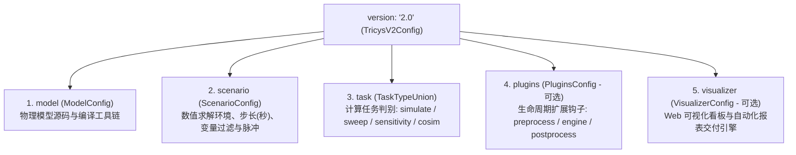
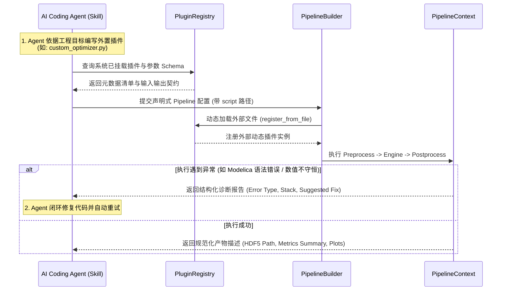
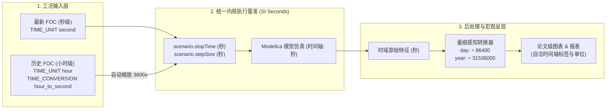
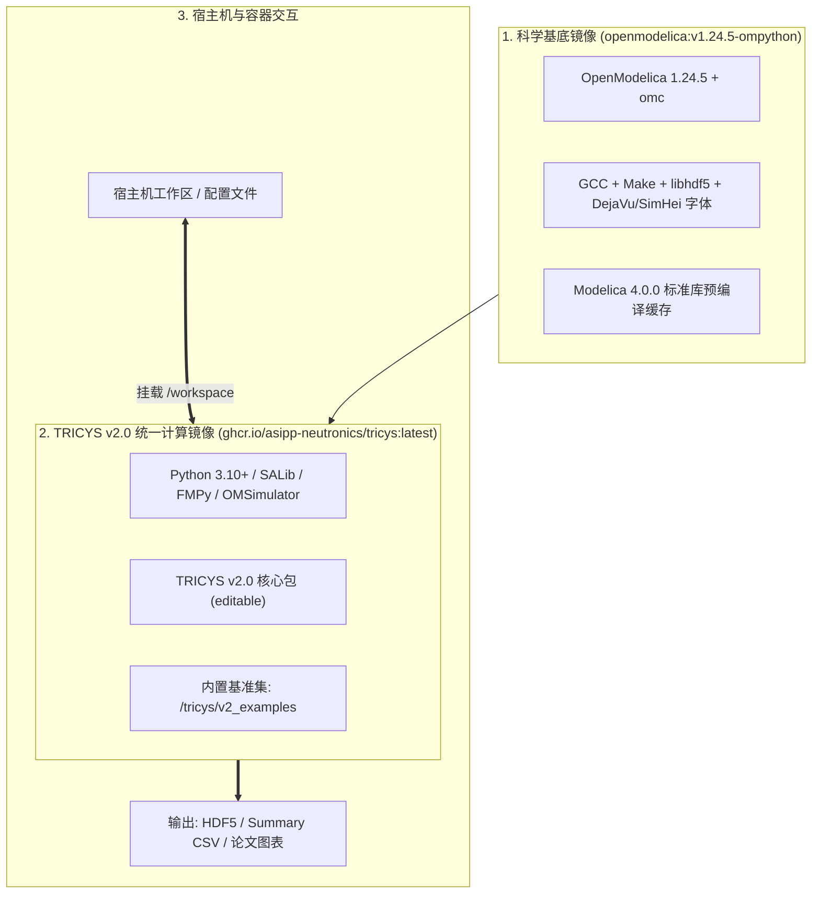

# [RFC] TRICYS v2.0 架构升级方案：可插拔工作流引擎、Schema 2.0 配置规范、Agent Skill 兼容、模型时间单位治理与 Docker 基准运行环境
 

## 📌 概述 (Overview)

随着聚变堆全厂氚循环研究向**精细化机理建模（全面转向以国际单位制“秒”为基准）**、**高维全局敏感性与不确定性分析（Sobol/LHS/Morris）** 以及 **AI Coding Agent 自动化辅助科研** 深水区演进，TRICYS 原有的面向过程脚本体系逐渐面临以下结构性挑战：
1. **工作流割裂与插件碎片化**：历史微插件（20~30行代码）过度细碎，生命周期缺乏统一契约，且存在外层 Case 进程池与内层仿真进程池嵌套死锁；
2. **配置层缺乏统一模式**：字段跨层深层侵入，缺乏类型约束与统一元数据定义；
3. **AI 智能体协作壁垒**：缺乏标准化的自描述元数据、动态外置扩展机制与自愈重试反馈协议；
4. **模型时间量纲冲突（[Issue #99](https://github.com/asipp-neutronics/tricys/issues/99)）**：过去 TRICYS 长期假定系统以**小时（`h`）**为时间单位；而最新机理模型已全面标准化为国际标准单位制**秒（`s`）**，框架中散落的历史小时硬编码假设导致了 3600 倍的时长失真与指标错位；
5. **环境异构与科研复现成本高**：OpenModelica、C 编译工具链、Python 科学计算依赖（SALib/HDF5）与前端看板的交叉依赖导致“环境地狱”，缺乏一键幂等复现基准案例的开箱即用容器底座。

为此，**TRICYS v2.0 确立了以“生命周期契约（Lifecycle Contract）”、“AI Agent 友好（Agent-Ready）”与“科学可复现（Reproducibility-First）”为核心的设计哲学**。本 RFC 旨在系统性介绍 v2.0 的五大核心架构设计思想与技术方案。

---

## 🏛️ 一、 工作架构升级：面向生命周期的可插拔工作流引擎

### 1. 核心设计思想

- **生命周期契约化（Lifecycle Contract & Pipeline-First）**：
  将一次完整的聚变计算抽象为规范的三阶段生命周期：
  $$\mathbf{Pipeline} = \mathbf{Preprocess} \longrightarrow \mathbf{SimulationEngine} \longrightarrow \mathbf{Postprocess}$$
  中间状态与数据流通过强类型的上下文对象（`PipelineContext`）在内存中单向流转，彻底阻断跨阶段直接耦合与全局隐式状态污染。
- **功能性插件矩阵（Functional Plugins Matrix）**：
  彻底打破碎片化的微插件，按聚变工程仿真业务领域重构为**高内聚的功能性插件**，每个插件承担明确的物理或数据处理职责。
- **数据流的“只读纯粹性”与“闭环控制”**：
  前处理负责输入解构、工况构建与统计抽样；仿真引擎负责受控并发求解；**后处理严格回归为只读消费者（Read-only Consumer）**，彻底切除“在后处理指标提取阶段偷偷拉起外部子进程跑仿真”的非受控暗桩。

### 2. 技术方案与核心构件

```mermaid
flowchart TD
    Config["YAML / JSON Configuration"] --> Builder[PipelineBuilder]
    Builder -->|生命周期编排与依赖注入| Pipeline[WorkflowPipeline]
    
    subgraph Stage1["1. 前处理阶段 (Preprocessing Plugins)"]
        Setup["SimulationSetupPlugin<br>• 工作区沙箱安全隔离<br>• 参数扫描空间离散化<br>• 全局统计抽样点注入"]
        Compiler["ModelCompilerPlugin<br>• OpenModelica 静态预编译<br>• C 二进制构建与依赖缓存"]
        FOC["FOCInjectorPlugin<br>• 聚变运行脉冲 DSL 解析<br>• 动态脉冲源注入打桩"]
        Interceptor["InterceptorBuilderPlugin<br>• 稳态/动态耦合接口解析<br>• Aspen/Modelica 变量拦截器"]
    end
    
    subgraph Stage2["2. 仿真执行阶段 (Simulation Engines)"]
        StandardEngine["StandardSimulationEngine<br>• 并行 C 二进制执行调度<br>• 闭环受控二分逼近寻优 (BisectionOptimizer)"]
        OfflineEngine["OfflineCoSimulationEngine<br>• Aspen / Modelica 松耦合文件协同"]
        OnlineEngine["OnlineCoSimulationEngine<br>• OMSimulator FMI 强耦合在线协同"]
    end
    
    subgraph Stage3["3. 后处理阶段 (Postprocessing Plugins - 只读消费)"]
        Storage["SimulationStoragePlugin<br>• 算子化特征指标提取<br>• 分层 HDF5 持久化与 CSV 导出"]
        Safety["SafetyAuditorPlugin<br>• 全厂氚质量平衡动态守恒审计<br>• 静态安全阈值越限告警检测"]
        Report["AnalysisReportPlugin<br>• 批处理分析任务执行<br>• 基准时间序列图表生成"]
        Sensitivity["SensitivityAnalysisPlugin<br>• Sobol/LHS 方差分解与不确定性分析<br>• 学术级论文多维配图导出"]
    end

    Pipeline --> Stage1
    Stage1 -->|"PipelineContext (jobs, package_path)"| Stage2
    Stage2 -->|"PipelineContext (results_dir, job_params)"| Stage3
    Stage3 --> Artifacts[("结构化结果 (HDF5 / Summary CSV / 论文图表)")]
```



#### (1) 统一数据传输对象 (`PipelineContext`)
`PipelineContext` 提供了强类型属性访问接口（`package_path`、`jobs`、`metrics_definition`、`results_dir`、`artifacts`），插件间数据传递全部经由 Context 记录与提取，阻断对非受控底层原始字典的直接渗透。

#### (2) 统一并发调度消解双层进程池死锁
针对多工况（Multi-cases）并发场景，调度器通过策略拦截，强制使每个 Case 内层的子任务仿真限制为 `max_workers = 1`，将两级并发解耦为单级拓扑，彻底杜绝外层进程池与内层仿真进程池相乘造成的 IPC 管道枯竭与系统死锁。协同仿真自动安全降级为严格顺序调度。

#### (3) 二分寻优在仿真执行层受控闭环
将自持 TBR 二分逼近求解（`BisectionOptimizer`）直接整合进仿真 Worker 中，在仿真期基于预编译二进制受控迭代收敛，并将最优 TBR 与自持指标随作业结果直接写入持久化层；后处理仅负责读取、合并与制图，不再在后处理提取指标时私自反向调用子进程跑仿真。

---

## 📋 二、 配置规范升级：Schema 2.0 体系与依赖注入

### 1. 核心设计思想

- **五大核心支柱体系（5 Core Pillars）**：
  将聚变仿真配置严格收敛为五大顶级业务支柱：
  $$\text{TricysV2Config} = \{\mathbf{model},\ \mathbf{scenario},\ \mathbf{task},\ \mathbf{plugins},\ \mathbf{visualizer}\}$$
- **任务判别联合体（Discriminated Task Union）**：
  科学计算任务被规范化为严格类型安全的 `task` 块，通过 `type` 字段（`simulate` / `sweep` / `sensitivity` / `cosim`）进行类型判别，杜绝了非法任务类型。
- **算子化特征提取与二分寻优融合（Operator-based Metrics）**：
  指标提取（`metrics`）统一采用“算子（Evaluate Operator）”抽象，包括极值、终值、拐点、倍增时间以及**二分逼近寻优（`bisection_search`）**，统一了单点、参数扫描和高维敏感性分析中的指标计算语义。
- **控制反转与依赖注入（IoC & Dependency Injection）**：
  `PipelineBuilder` 充当 IoC 容器，在装配期直接将解析好的专属参数子集注入到插件构造函数中（如 `SafetyAuditorPlugin(auditor_config=..., alarm_rules=...)`）。插件内部优先使用构造函数参数，与底层原始配置字典彻底解耦。

### 2. Schema 2.0 五大核心支柱与多层级字段定义



#### 支柱 1：`model`（物理模型定义与编译器选项）
- `fileName` *(string, required)*: Modelica 源码文件路径（支持 `.mo` 或包入口 `package.mo`）。
- `modelName` *(string, required)*: 仿真顶级模型类全限定名（如 `example_model.Cycle` 或 `CFEDR_3LC.System`）。
- `loadModel` *(list[dict], optional)*: 依赖的标准或第三方 Modelica 库声明（如 `[{"name": "Modelica", "version": "4.0.0"}]`）。
- `cflags` *(string, default: "")*: 传递给底层的 C 编译器优化选项（如 `-O3`）。
- `target` *(string, default: "gcc")*: 目标编译工具链（`gcc` / `msvc`）。

#### 支柱 2：`scenario`（数值求解工况与积分环境）
- `stopTime` *(float, required)*: **仿真终止时间（严格以国际单位制“秒”为基准，float > 0）**。
- `startTime` *(float, default: 0.0)*: 仿真起始时间（秒）。
- `stepSize` *(float, default: 1.0)*: 通讯积分步长 / 输出采样间隔（秒）。
- `numberOfIntervals` *(int, optional)*: 输出采样点总数（与 `stepSize` 互斥生效）。
- `method` *(string, default: "dassl")*: OpenModelica 数值积分求解算法（`"dassl"`, `"ida"`, `"cvode"`, `"rungekutta"`）。
- `tolerance` *(float, default: 1e-6)*: 求解器相对数值容差。
- `outputFormat` *(string, default: "csv")*: 原始结果持久化格式（`"csv"` / `"mat"`）。
- `variableFilter` *(string, default: ".*")*: **变量输出正则过滤器**（如 `"time|sds.I[1]|sds.I[2]"`），仅截取关键变量，大幅减轻 I/O 与存储开销。
- `pulse` *(dict, optional)*: 动态聚变脉冲工况注入（`foc_file` 脚本路径、`target_component` 替换组件名、`power_scale` 功率缩放因子）。

#### 支柱 3：`task`（科学计算任务判别联合体）
通过 `type` 字段严格派生为四类计算载荷，并在其内部定义统一的 `metrics` 提取规范：

1. **单点仿真 / 单点寻优任务 (`type: "simulate"`)**
   - `parameters` *(dict)*: 标称工况单点参数覆盖（如 `{ "WDS.threshold": 1200.0 }`）。
   - `metrics` *(dict)*: 特征指标提取规则。
2. **多工况参数扫描任务 (`type: "sweep"`)**
   - `parallel` *(bool, default: false)*: 是否开启多进程并行计算。
   - `max_workers` *(int, optional)*: 最大并行核心限额。
   - `parameters` *(list[dict] | dict)*: 扫描空间定义：
     - 支持**离散多工况列表**：`[{"name": "Case1", "TBR": 1.15}, {"name": "Case2", "TBR": 1.25}]`；
     - 支持**网格矩阵**：`{"blanket.TBR": [1.05, 1.15, 1.25], "tep.eta": [0.8, 0.9]}`；
     - 支持**外部参数文件**：`{"file": "sweep_space.csv"}`。
3. **全局敏感性与不确定性分析 (`type: "sensitivity"`)**
   - `method` *(string)*: 全局采样与方差分解方法（`"sobol"`, `"latin"`, `"morris"`）。
   - `samples` *(int)*: 统计抽样基数 $N$（如 64, 128, 1024）。
   - `seed` *(int, optional)*: 随机数种子。
   - `parameters` *(dict)*: 待采参数的不确定性边界 `[min, max]` 或统计分布规范。
4. **多物理场协同仿真 (`type: "cosim"`)**
   - `mode` *(string)*: 耦合模式（`"subsystem_replacement"` 松耦合替换 / `"fmi_online"` 强耦合在线协同）。
   - `exchange_step` *(float)*: 宏观数据交换通讯间隔（秒）。
   - `subsystems` *(list[dict])*: 参入协同的外系统规格（目标组件、适配求解器 `aspen_plus` / `h2iso` / `fmu`、模型文件等）。

##### 统一指标算子层（`task.metrics` 规范）
每个指标定义均支持强类型的多维算子：
- `source` *(string)*: 观察的时域变量名（如 `"sds.I[1]"`）。
- `evaluate` *(string)*: 特征评估算子，包括：
  - 常规时域特征：`"peak_value"`, `"min"`, `"max"`, `"final_value"`, `"integral"`, `"mean"`, `"settling_time"`；
  - 动态拐点分析：`"turning_point"`（配合 `threshold` 和 `direction: "min_to_max"`）；
  - 氚工程特征：`"doubling_time"`（配合 `factor: 2.0`）；
  - **闭环二分逼近寻优**：`"bisection_search"`（配合 `parameter` 调优目标、`search_bounds: [1.0, 1.4]`、`tolerance`、`max_iterations` 及内层 `target_metric` 目标准则）。

#### 支柱 4：`plugins`（生命周期扩展钩子，可选）
允许用户或 Agent 显式向生命周期中挂载功能性扩展：
- `preprocess` *(list[dict])*: 仿真前执行的插件链。
- `simulation_engine` *(dict)*: 自定义仿真执行引擎覆写（`type`, `params`）。
- `postprocess` *(list[dict])*: 仿真后执行的插件链（如已内置的守恒审计 `mass_conservation`、结果归档 `archive`、告警检测等）。
- *扩展语法*：支持直接以 `"script": "./my_plugin.py"` 或 `"plugin": "plugin_alias"` 装配，并传递专属 `params`。

#### 支柱 5：`visualizer`（可视化看板与自动化报表交付引擎，可选）
- `enabled` *(bool, default: true)*: 是否开启可视化服务。
- `port` *(int, default: 8080)* / `host` *(string)*: Web 看板监听地址与端口。
- `launch_on_finish` *(bool, default: false)*: 仿真完成后是否自动呼起默认浏览器。
- `report` *(dict, optional)*: 内置工程报告生成引擎（指定导出格式 `["markdown", "pdf", "html"]`、报告章节列表以及 `ai_insight` 大模型工程洞察生成开关）。

### 3. 当前 `v2_examples/` 生产级配置文件样例

#### (1) 多工况离散扫描与指标提取 (`sweep_cases.yaml`)
```yaml
version: "2.0"

model:
  fileName: "../example_model_single/example_model.mo"
  modelName: "example_model.Cycle"

scenario:
  stopTime: 2000.0  # SI 秒
  stepSize: 0.5     # SI 秒
  method: "dassl"
  variableFilter: "time|sds.I[1]"

task:
  type: "sweep"
  parallel: true
  max_workers: 4
  parameters:
    - name: "Case_Standard_1.15"
      TBR: 1.15
      WDS.threshold: 1200.0
    - name: "Case_HighTBR_1.25"
      TBR: 1.25
      WDS.threshold: 1500.0
    - name: "Case_Conservative_1.08"
      TBR: 1.08
      WDS.threshold: 1000.0
  metrics:
    max_inv:
      source: "sds.I[1]"
      evaluate: "max"

visualizer:
  launch_on_finish: false
```

#### (2) 嵌套受控二分寻优与插件扩展 (`sweep_bisection.yaml`)
```yaml
version: "2.0"

model:
  fileName: "../example_model_single/example_model.mo"
  modelName: "example_model.Cycle"

scenario:
  stopTime: 2000.0
  stepSize: 0.5
  method: "dassl"
  variableFilter: "time|sds.I[1]"

task:
  type: "sweep"
  parameters:
    - name: "Case_LowPulsing"
      tf: 100.0
    - name: "Case_HighPulsing"
      tf: 200.0
  metrics:
    Required_TBR:
      evaluate: "bisection_search"
      parameter: "TBR"
      search_bounds: [1.0, 1.4]
      tolerance: 0.001
      max_iterations: 15
      target_metric:
        source: "sds.I[1]"
        operator: "min"
        target_value: 1000.0

plugins:
  postprocess:
    - name: "auditor"
      plugin: "mass_conservation"
      tolerance: 0.0001
    - name: "auto_archive"
      plugin: "archive"
      format: "zip"

visualizer:
  launch_on_finish: false
```

#### (3) Sobol 全局敏感性分析 (`sensitivity_sobol.yaml`)
```yaml
version: "2.0"

model:
  fileName: "../example_model_single/example_model.mo"
  modelName: "example_model.Cycle"

scenario:
  stopTime: 1000.0
  stepSize: 1.0
  method: "dassl"
  variableFilter: "time|sds.I[1]"

task:
  type: "sensitivity"
  method: "sobol"
  samples: 64
  seed: 42
  parameters:
    TBR: [1.05, 1.35]
    WDS.threshold: [800.0, 1600.0]
  metrics:
    final_storage:
      source: "sds.I[1]"
      evaluate: "final_value"

visualizer:
  launch_on_finish: false
```

### 4. 依赖注入与向后兼容落地机制

- **自动依赖装配流程（`PipelineBuilder`）**：
  读取配置后，`PipelineBuilder` 将 `model` 与 `scenario` 属性绑定至 Context；将 `task.parameters` 或抽样空间交付前处理 `SimulationSetupPlugin` 展开为作业矩阵；将 `task.metrics` 注入后处理 `SimulationStoragePlugin` 进行多维特征计算；将 `plugins.postprocess` 动态实例化加载（如 `mass_conservation` 对应 `SafetyAuditorPlugin`）。
- **100% 存量兼容（Synthetic Properties）**：
  在 `TricysV2Config` 数据类中内置了合成兼容属性（如 `@property def paths(...)` 与 `@property def simulation(...)`），旧版代码或历史分析脚本无需改动即可在内存中透明映射运行。

---

## 🤖 三、 兼容 Agent Skill：AI Coding Agent 友好的仿真基础设施

### 1. 核心设计思想

- **从“人工专用仿真包”到“AI 智能体基础设施（Agent-Ready Infrastructure）”**：
  随着大语言模型和通用智能体（如 Google Antigravity、Claude Code、Cursor）进入聚变科研开发流，TRICYS 需要具备被 Agent 快速理解、自主编排、自愈调优的能力。
- **协议重于代码（Protocol-over-Code）**：
  Agent 在实现新算法、特定后处理或自定义安全规则时，**不需要通过侵入式修改 TRICYS 核心源码包的方式工作**，而是通过定义规范的“Agent Skill”协议，实现动态加载与热插拔。

### 2. 技术方案与交互机制



- **零侵入式动态脚本装配 (`script` / `module`)**：
  允许 Agent 将写好的独立 Python 脚本放置在工作区任意路径，在配置中声明 `"script": "./agent_skills/my_plugin.py"`，流水线启动时通过 `PluginRegistry.load_class_from_source()` 动态编译加载并自动校验插件接口签名。
- **自描述元数据契约（Self-Describing Metadata）**：
  每个功能性插件均实现统一的元数据契约（包含 `name`、`version`、`input_requirements`、`output_artifacts`、`parameter_schema`）。Agent 可通过内置 CLI 工具（如 `tricys plugin list --json`）单次查询获取全量能力清单，便于自主组装流水线。
- **结构化错误返回与自修复协议（Self-Correction Protocol）**：
  工作流中设立统一的异常屏障（Exception Barriers）。当出现 Modelica 编译失败、数值积分发散或守恒审计不达标时，抛出包含**错误定位、因果诊断与修复建议**的结构化 JSON 报告，直接作为 Agent Skill 的 Tool Result，使智能体能够自主判断并自动调整参数重试。

---

## ⏱️ 四、 修复适配最新模型时间单位：拥抱 SI 秒基准与全链路时间量纲治理

### 1. 核心设计思想与 Issue #99 痛点溯源

- **背景与历史包袱（[Issue #99](https://github.com/asipp-neutronics/tricys/issues/99)）**：
  在过去（TRICYS v1.x），系统主要服务于早期的全厂稳态或大尺度慢动态模型，代码库和后处理中长期隐式假定**时间基准为“小时（`h`）”**（例如将时间轴除以 24 换算为天、除以 8760 换算为年，仿真时长和流率默认均按小时处理）。
- **最新模型的物理标准化转变**：
  随着聚变堆全厂物理建模深化，与 OpenModelica 标准库（MSL）及最新机理模型（如新一代精细化托卡马克/包层动力学模块）接轨，**最新模型已全面统一升级采用国际标准单位制（SI）的“秒（`s`）”作为基本仿真时间单位**。
- **核心矛盾与严重风险**：
  若底层物理模型的时间量纲已全面切换为秒（`s`），而外层框架依然保留旧有的小时（`h`）假设，将引发严重的系统性偏差：
  1. **仿真时长理解偏离 3600 倍**：用户若在配置中设定 `stopTime: 86400`（预期模拟 1 天 86400 秒），在旧逻辑中若仍被视作小时，将导致误算为 10 年长程演化；
  2. **特征指标计算严重失真**：关键工程指标（如自持倍增时间 `Doubling_Time`、自持拐点时间 `Self_Sufficiency_Time`）若直接套用历史公式（除以 24 或 8760），计算出的工程天数将**被成倍放大 3600 倍**，彻底丧失工程参考价值；
  3. **脉冲工况 (FOC) 注入缩放错乱**：按秒编写的高频脉冲若被灌入错误假设的时间轴，会导致占空比和充放氚功率严重畸变。
- **治理思想**：**彻底确立国际标准单位制秒（SI seconds）为第一公民，建立全链路显式时间量纲契约，消除一切隐式魔法常数**。

### 2. 技术方案



#### (1) 求解内核与配置层全面标定为 SI 秒 (`stopTime`, `stepSize`)
在 Schema 2.0 中，`scenario.stopTime`、`scenario.stepSize`、`scenario.startTime` 明确标定为以**秒（SI seconds）**为单位，彻底废除过去模糊的无量纲数值。

#### (2) FOC 脉冲工况双头指令解析机制（原生支持秒，兼顾历史小时文件）
为了适配最新以秒为基准的模型，同时兼容科研人员手中积累的历史小时级工况，`.foc` 语法增强了时间头指令：
```foc
# 场景 A: 最新规范——以秒编写，直接对应最新秒级模型 (无任何换算开销)
TIME_UNIT second
TIME_CONVERSION NONE
PULSE 1000 1800 900 10  # 1800s 脉冲, 900s 间歇

# 场景 B: 兼容历史——以小时编写的老工况，显式声明换算至秒
TIME_UNIT hour
TIME_CONVERSION hour_to_second  # 自动乘以 3600 换算为秒
PULSE 1000 0.5 0.25 10
```
- **技术实现**：由 `FOCInjectorPlugin` 在预处理期静态解析头指令，自动计算转换比率并重构时间轴，从源头切除脉冲时间压缩或拉伸 3600 倍的隐患。

#### (3) 后处理指标提取器的 SI 秒量纲重构 (Unit-Aware Metric Extractor)
- 指标提取算子统一将输入时序数据严格视为**秒（`s`）**；
- 当需要输出宏观工程指标（如天、年）时，指标提取器通过规范化的 `conversion_factor` 进行显式、可追踪的换算：
  ```yaml
  metrics:
    Doubling_Time:
      source: "sds.I[1]"
      evaluate: "doubling_time"
      unit: "year"
      conversion_factor: 31536000.0  # 基于秒的年换算系数 (365d * 86400s)
    
    Self_Sufficiency_Time:
      source: "sds.I[1]"
      evaluate: "turning_point"
      unit: "day"
      conversion_factor: 86400.0     # 基于秒的天换算系数 (24h * 3600s)
  ```
- 学术图表 x 轴与结果报表表头自动依据 `unit` 渲染，彻底阻断了任何历史小时硬编码残留，圆满解决 Issue #99。

---

## 🐳 五、 完备 TRICYS v2.0 基准案例 Docker 运行环境：一键复现与云原生仿真底座

### 1. 核心设计思想

- **科学计算的“零配置可复现性（Reproducibility-First）”**：
  聚变氚循环科学仿真涉及庞大而异构的底层生态链：OpenModelica（`omc`、Modelica 4.0 标准库、C 编译器 `gcc`/`make`）、Python 科学技术栈（NumPy/SciPy/Pandas/Tables/HDF5/SALib/FMPy/OMSimulator）以及配套的 Node.js/Vue3 Web 看板。
  在跨平台裸机（Windows/Linux/macOS）上直接配置往往遭遇环境地狱（C 依赖版本冲突、动态库缺失、中文字体丢失导致绘图发散）。
  v2.0 确立了**“基准案例即容器服务（Benchmark-as-a-Container）”**的思想，实现任何评审人、研究员或 AI Agent **仅需单条 Docker 命令即可 100% 幂等复现全部计算结果**。
- **科学计算与可视化呈现的多阶段分层解耦**：
  将计算密集的底层仿真运行时（CLI / Batch Computing）与上层富交互看板（Fullstack Web Dashboard）解耦，既为 HPC 高性能集群/云原生批量扫参提供轻量镜像，又为实验室交互演示提供一体化容器方案。

### 2. 技术方案与容器拓扑



---

## 🎯 总结与征求意见 (Conclusion & Feedback)

TRICYS v2.0 的本质是**从“面向特定功能调用的计算包”进化为“现代化、规范化、Agent 友好且云原生可复现的聚变氚循环科学仿真框架”**：
- **架构上**，依靠生命周期流水线与高内聚功能性插件，彻底消除了深层嵌套死锁与数据反向渗透；
- **配置上**，推行基于“五大核心支柱”与“任务判别联合体”的 Schema 2.0，代码实现（`tricys/core/schema.py`）与实际用例（`v2_examples/`）高度自洽，并对历史用例保持无损兼容；
- **AI 生态上**，确立 Agent Skill 扩展协议，使 TRICYS 成为可供 AI 智能体自主编排和自愈调优的基础底座；
- **物理机理上**，全面拥抱国际标准单位制秒（SI seconds），确立全链路时间量纲显式契约，完美适配以秒为基准的最新物理模型并消除历史小时制误差；
- **工程交付上**，依托开箱即用的 Docker 容器化底座，实现跨平台“零环境配置”的学术论文基准一键复现。

欢迎团队成员针对上述五大板块的设计思想、Schema 2.0 命名规范与外部扩展接口提出宝贵建议！