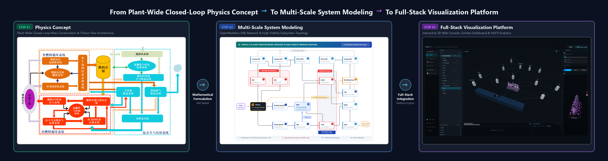

# TRICYS: 聚变堆全厂氚循环集成仿真平台

[](./pyproject.toml)
[](./LICENSE)
[](https://www.python.org/)
[](https://github.com/asipp-neutronics/tricys/pkgs/container/tricys)
[](https://asipp-neutronics.github.io/tricys/)
[](https://openmodelica.org/)

[English](README.md) | [简体中文](README_zh.md)




## 1. 核心定位 (Overview)

**TRICYS** (**TR**itium **I**ntegrated **CY**cle **S**imulation) 是一个开源、模块化、多尺度的聚变堆氚燃料循环仿真器，旨在提供基于物理的动态闭环分析，并严格遵守全厂范围的质量守恒原则。

我们的目标是为研究人员和工程师提供一个灵活且强大的平台，用于探索各种氚管理策略、优化系统设计，并深入理解聚变反应堆环境中氚的流动与库存动态。

---

## 2. Docker 极速体验 (Quick Start: 5 Steps)

通过开箱即用的 All-in-One 单容器镜像，快速体验 TRICYS 全栈多物理场仿真与数字孪生：

### 2.1. 拉取官方单容器镜像
```bash
docker pull ghcr.io/asipp-neutronics/tricys:latest
```

### 2.2. 一键启动全栈平台并进入终端
```bash
docker compose up -d
docker exec -it -u appuser tricys_allinone bash
```
> **跨平台无缝兼容**：`docker-compose.yml` 已内置智能 X11 双轨桥接机制，无论是 Windows 11（WSLg）还是原生 Linux（`/tmp/.X11-unix`）均开箱即用，统一运行上述单条命令即可。

### 2.3. 打开图形化建模环境 OMEdit
在容器终端中输入命令（后台运行以保持终端可用，已默认自动载入 `example_model` 模型库及其 20 个子模型）：
```bash
OMEdit &
```

### 2.4. 运行基准算例 01 并通过链接直达可视化
在容器终端中直接执行：
```bash
tricys example --run 1
```
运行完成后，终端将直接输出 Visualizer 的交互跳转链接（包含鉴权 Token，例如 `http://localhost:8050/hdf5/?token=...`），**直接复制该链接去宿主机浏览器中打开查看即可**；同时会在产物目录自动生成包含多工况分析的 Markdown、Word 与 PDF 格式工程报告。

### 2.5. 在浏览器中打开 TRICYS 可视化平台
在宿主机浏览器中可直接访问全栈服务：

| 服务名称 | 访问地址 | 核心能力说明 |
| :--- | :--- | :--- |
| **统一 Web 控制台** | [http://localhost:8080](http://localhost:8080) | 全栈反向代理网关、Vue3 仿真工作台与系统监控 |
| **数字孪生大屏** | [http://localhost:8080/goview/](http://localhost:8080/goview/) *(或 :3020)* | GoView 聚变堆全厂氚循环可视化大屏 |
| **HDF5 科学交互大图** | [http://localhost:8080/hdf5/](http://localhost:8080/hdf5/) *(或 :8050)* | Dash/Plotly 多工况曲线与氚自持边界交互分析 |
| **FastAPI 接口文档** | [http://localhost:8000/docs](http://localhost:8000/docs) | OpenAPI / Swagger 交互式 REST API 接口文档与测试 |

---

## 3. 官方文档分流中心 (Documentation Portal) 

| 核心支柱 | 重点内容索引 |
| :--- | :--- |
| **1. 入门教程** | 环境准备、5 分钟极速上手、V1 到 V2 零代码修改无缝迁移指南 |
| **2. 任务向导** | Schema 2.0 配置、瞬态动力学、脉冲调度、Sobol 敏度、协同仿真与质量审计 |
| **3. 方法理论** | 物理模型、软件架构等程序及数学理论证明 |
| **4. 验证与基准** | **Abdou 2021 V&V** 与 12 大基准算例 |
| **5. 参考规范** | CLI 机器可读协议字典、Schema 2.0 完整规约、Python API 参考与四级自愈树 |

---

## 4. 学术引用与理论基准 (Citation & References)

### 4.1. TRICYS 平台引用
如果在科研工作或学术论文中使用了 TRICYS 平台，请按以下格式引用核心文献：

```bibtex
@article{tricys2026,
  title   = {TRICYS: A Multi-Scale Integrated Simulation Platform for Fusion Reactor Tritium Fuel Cycle},
  author  = {},
  journal = {},
  year    = {2026}
}
```

### 4.2. 理论验证与基准对标文献 (V&V & Benchmark References)
TRICYS 的系统动力学理论内核与工程基准算例严格对标并复现了聚变自持理论与工程设计成果，请同时参阅并引用以下基础文献：

- **Abdou 2021 聚变燃料自持基准**（完整复现 292 个离散点理论验证数据集，对标 *Nuclear Fusion*, 61, 013001，独立开源托管于 [`couuas/tricys_abdou_2021`](https://github.com/couuas/tricys_abdou_2021)）：
```bibtex
@article{abdou2021physics,
  title = {Physics and technology considerations for the deuterium--tritium fuel cycle and conditions for tritium fuel self-sufficiency},
  author = {Abdou, M. A. and Riva, M. and Day, C. and Loarte, A. and Boccaccini, L. V. and Clark, R. and Henders, M. and others},
  journal = {Nuclear Fusion},
  volume = {61},
  number = {1},
  pages = {013001},
  year = {2021},
  doi = {10.1088/1741-4326/abbf35}
}
```

- **Jin 2026 CFEDR 全厂氚循环系统仿真基准**：
```bibtex
@article{jin2026cfedr,
  title = {CFEDR tritium fuel cycle model and tritium self-sufficiency analysis},
  author = {Jin, Chuan and Zhang, Xiaokang and Gui, Long and Jiang, Yingwu and Zheng, Shanliang},
  journal = {Fusion Engineering and Design},
  volume = {228},
  pages = {115766},
  year = {2026},
  doi = {10.1016/j.fusengdes.2026.115766}
}
```

---

## 5. 开源协议与社区共建 (License & Contributing)

- **问题反馈与共建**：欢迎通过 [GitHub Issues](https://github.com/asipp-neutronics/tricys/issues) 提交缺陷报告或改进建议。
- **开源协议**：本项目基于 [Apache-2.0 License](./LICENSE) 开源。Copyright © 2024–2026 ASIPP.
