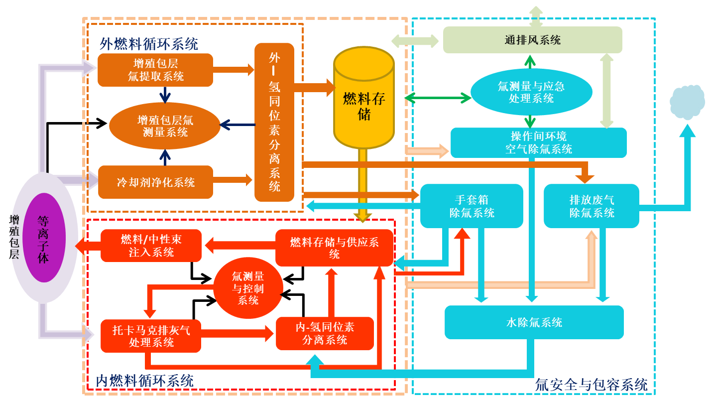

# TRICYS - 氚燃料循环集成仿真平台

[](./LICENSE)
[](https://www.python.org/downloads/)
[](https://asipp-neutronics.github.io/tricys/)

**TRICYS** (**TR**itium **I**ntegrated **CY**cle **S**imulation) 是一个开源、模块化、多尺度的聚变堆氚燃料循环仿真器，旨在提供基于物理的动态闭环分析，并严格遵守全厂范围的质量守恒原则。

我们的目标是为研究人员和工程师提供一个灵活且强大的平台，用于探索各种氚管理策略、优化系统设计，并深入理解聚变反应堆环境中氚的流动与库存动态。

在本文档中，`TRICYS` 有两个常用语义：狭义上指 `tricys` 核心仿真引擎，广义上指由 `tricys`、`tricys_backend`、`tricys_visual` 和 `tricys_goview` 共同组成的 TRICYS 平台。



## TRICYS 核心是什么

这里的 TRICYS 是狭义概念，特指 `tricys` 核心仿真引擎。它负责聚变堆氚燃料循环的物理建模、Modelica 集成、参数扫描、敏感性分析以及报告生成。若您的目标是运行模型、分析结果、复现示例或在本地进行算法研究，通常只需要先完成 TRICYS 核心的部署。

核心能力主要包括：
- **参数扫描与并发**: 系统地研究多个参数对系统性能的影响，支持并发运行和大规模批量仿真。
- **子模块协同仿真**: 支持与外部工具（如 Aspen Plus）进行数据交换，完成子模块系统集成。
- **自动化报告生成**: 自动生成标准化的 Markdown 分析报告，包含图表、统计数据和可视化结果。
- **高级敏感性分析**: 支持系统参数的自定义敏感性分析，并集成SALib库量化参数对输出的影响
- **AI 增强分析**: 集成大型语言模型（LLM），能够将原始的图表和数据自动转化为结构化的学术风格报告。

## TRICYS 平台是什么

这里的 TRICYS 是广义概念，指整个 TRICYS 平台，而不只是一个 Python 包。它是一套由核心仿真、后端服务和前端应用协同组成的平台：

- **`tricys` (核心引擎)**: 负责物理建模、Modelica 集成、参数扫参以及基于 AI 的科研报告生成的 Python 核心库。
- **`tricys_backend` (后端服务)**: 基于 FastAPI 的高性能 RESTful 服务，管理仿真任务队列、WebSocket 日志流推送以及 HDF5 数据切片服务。
- **`tricys_visual` (前端主控台)**: 基于 Vue 3 的现代前端框架，提供实时的 3D 数字孪生可视化、拓扑配置编辑器和仿真进度监控。
- **`tricys_goview` (独立大屏)**: 基于 Vue 3 GoView 架构开发的独立低代码数据大屏，用于渲染高级的全局分析与对比视图。

不同的使用目标，对应不同的启动方式：
- 如果您只想运行模型、示例和分析流程，优先部署 `tricys` 核心。
- 如果您希望体验完整平台，包括后端接口、主控前端和 GoView 大屏，则部署全栈平台。

## 快速开始 TRICYS 核心

为确保与 Aspen Plus 等外部 Windows 软件的协同仿真功能完全兼容，核心仿真优先推荐 Windows 本地安装。

### 1. 环境要求
1. **Python**: 建议使用 Python 3.10+，最低支持 Python 3.8。
2. **Git**: 建议使用 Git 2.40+，用于克隆代码仓库和同步子模块。
3. **OpenModelica**: 建议使用 OpenModelica 1.24+，并确保其命令行工具 `omc.exe` 已加入 `PATH`。

### 2. 部署步骤

1. **克隆项目仓库**
   ```shell
   git clone https://github.com/asipp-neutronics/tricys.git
   cd tricys
   ```

2. **运行部署向导**
   仓库提供统一的部署入口，会自动检查环境、在依赖缺失时给出建议版本，并让您选择部署模式。
   ```shell
   Makefile.bat
   ```
   或者显式执行：
   ```shell
   Makefile.bat deploy
   ```

3. **选择 `core-local` 模式**
   该模式会完成：
   - 本地 Python 核心环境安装。
   - OpenModelica 注册。
   - `tricys` 可编辑安装。

### 3. 运行一个示例

安装完成后，您可以启动交互式示例运行器，快速体验 TRICYS 核心能力：

```shell
tricys example
```

该命令会扫描并列出所有可用的基础和高级分析示例。您只需根据提示输入数字，即可自动运行对应的示例任务。

## 快速部署 TRICYS 平台

如果您希望在本地环境中同时运行整个项目生态，包括后端引擎、HDF5 可视化服务以及两套前端页面，建议使用仓库现有的部署向导或生命周期命令。

### 1. 使用部署向导

```bash
# Windows 默认入口
Makefile.bat

# Windows 显式入口
Makefile.bat deploy

# Linux 默认入口
make

# Linux 显式入口
make deploy
```

部署向导支持三种模式：
- `core-local`：本地安装 Python 核心能力并注册 OpenModelica。
- `fullstack-local`：本地启动 backend、hdf5、visual 和 goview 开发栈。
- `docker-fullstack`：通过 Docker Compose 启动完整容器化栈。

如果您要部署整个平台，一般选择：
- Windows 或本地开发环境：`fullstack-local`
- 容器化部署或标准 0D 使用场景：`docker-fullstack`

### 2. 使用生命周期命令

如果您希望跳过交互式向导，也可以直接使用统一的生命周期命令：

```bash
# 安装本地全栈依赖
Makefile.bat app-install

# 启动 backend、hdf5、visual 和 goview
Makefile.bat app-start

# 停止本地全栈服务
Makefile.bat app-stop
```

这些命令会统一调用 `script/dev/windows/` 或 `script/dev/linux/` 下的现有脚本，和仓库其余生命周期命令保持一致，并支持部署前状态判断、停服务清理等改进逻辑。

### 3. Docker 部署方案

TRICYS 现已收敛为**唯一官方 Docker 镜像**：`ghcr.io/asipp-neutronics/tricys:latest`。
镜像基于 DOLFINx 0.9.0，全面集成了 OpenModelica 1.27 + MSL 固化库、FESTIM 2.0 有限元解算器、CasADi 氢同位素低温精馏解算器、FMPy 多速率协同仿真运行时，以及 FastAPI 后端、Vue3 控制台、GoView 大屏和 Dash/Plotly HDF5 科学交互可视化服务。

仓库提供标准编排配置与容器化执行支持：

1. **单容器全栈运行时（`docker-compose.yml`）**：
   采用单容器 All-in-One 架构，同时挂载本地 `tricys`、`tricys_backend` 及 `h2iso` 等子仓库源码，一键启动全栈服务（Web Console/网关: 8080, Backend: 8000, GoView: 3020, HDF5: 8050）：
   ```bash
   docker compose up -d --build
   ```

2. **容器内执行测试集与自定义工作流**：
   无需在宿主机配置复杂底层依赖，直接通过容器执行测试集或仿真任务：
   ```bash
   # 执行完整自动化测试集
   docker compose run --rm tricys pytest

   # 执行自定义仿真工作流
   docker compose run --rm tricys run -c path/to/your_config.yaml
   ```

如果您在 VSCode 中使用 Dev Containers：

1. 克隆仓库并在 VSCode 中打开。
2. 按提示选择“在容器中重新打开”。
3. 容器启动后，根据使用场景执行：
   ```bash
   make dev-install
   ```

## 交互式部署向导说明

如果您希望使用单一入口完成环境检查、部署方式选择和后续启动，也可以直接运行原生脚本：

```bash
# Windows
script\dev\windows\deploy.bat

# Linux
bash ./script/dev/linux/deploy.sh
```

部署向导会：
- 检查 Python、Git、Node.js、npm、Docker、Compose、OpenModelica 等关键依赖。
- 在依赖缺失时给出建议版本。
- 检测当前是否已有本地全栈或 Docker 栈在运行。
- 在检测到本地 fullstack 已运行时，提示您选择跳过、先停再起或继续。

##  文档

获取更详细的功能介绍、配置指南和高级教程，请访问我们的[在线文档](https://asipp-neutronics.github.io/tricys/)。

##  贡献

我们欢迎社区的任何贡献！如果您希望参与 `tricys` 的开发，请遵循以下规范：

- **代码风格**: 使用 `black` 进行代码格式化，`ruff` 进行风格检查和修复。
- **命名规范**: 遵循 `snake_case` (变量/函数) 和 `PascalCase` (类) 的约定。
- **文档字符串**: 所有公共模块、类和函数都必须包含 Google 风格的文档字符串。
- **测试**: 使用 `pytest` 编写单元测试，并确保高覆盖率。
- **Git 提交**: 遵循 [Conventional Commits](https://www.conventionalcommits.org/) 规范，使提交历史清晰可读。

##  许可证

本项目采用 [Apache-2.0](./LICENSE) 许可证。
