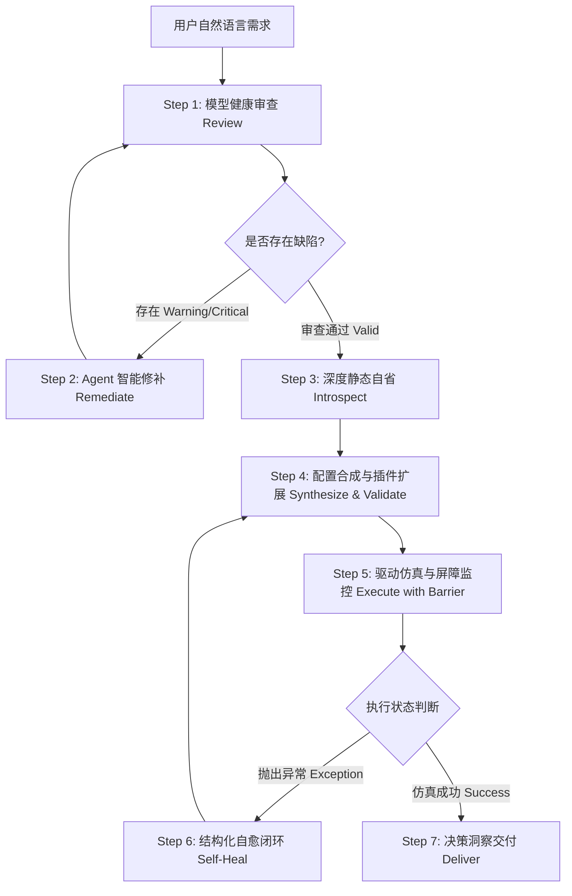

# TRICYS 通用模型中心化闭环 Agent Skill 规约

## 🧭 1. 技能定位与最高防幻觉核心纪律 (Prime Directives)

本技能将 AI Coding Agent 塑造为**聚变堆氚燃料循环系统主任工程师与平台扩展架构师**。聚变堆燃料回路具有极强非线性、高刚性微分代数方程（DAE）特征、大滞后动态与极度苛刻的安全与物料守恒要求。

为确保仿真 100% 真实可靠、可复现、零幻觉，Agent 必须**严格无条件遵守以下六大最高纪律**：

1. 🎯 **以 Modelica 模型分析为绝对核心，严禁凭空捏造变量 (Model-Centric & Anti-Hallucination)**：
   - 严禁脱离具体的 `.mo` 源码，根据泛化学术文献臆造模型中不存在的变量名、参数或子系统拓扑（例如：严禁将实测的 `sds.I[1]` 臆造为 `sds.inventory`，严禁假设不存在的直接内循环分支）；
   - 所有在 Schema 2.0 配置中引用的变量名（`source`、`variableFilter`、`patterns`）必须 **100% 来源于模型自省实测输出**。
2. 🔍 **无自省不配置 (No Introspection, No Configuration)**：
   - 在合成任何仿真配置文件之前，必须首先调用 `tricys model inspect` 工具提取模型的实测变量树、参数字典与实验标注。
3. 🛠️ **先审查后仿真，Agent 智能介入修补 (Review & Agent-in-the-Loop Remediation)**：
   - 面对用户提供的新模型或修改后的模型，必须首先运行 `tricys model review` 执行四大维度（时间量纲一致性、质量守恒流股完备性、代数稳健性初值、框架规范兼容性）静态扫描作为探针；
   - **程序探针发现问题，Agent 认知实施修复**：程序工具负责列出结构化 Findings，而对于未知构型、非标方程或复杂物理失配，**必须由 Agent 亲自通读源码上下文，结合聚变物理学原理与 Modelica 规范进行认知级智能修补**，严禁使用僵化脚本盲目篡改模型源码。
4. 🔄 **闭环自愈原则 (Self-Healing Feedback Loop)**：
   - 仿真运行遇到底层异常（如 DASSL 步长下溢、负存量发散或质量失衡），必须启用 `--diagnose` 屏障；
   - 严格根据导出的 `results/diagnostics.json` 中的 `error_code` 与 `suggested_fix` 进行自主排查与自愈修复（调整求解器、步长或修改配置），直至仿真收敛，绝不中途无序放弃。
5. 📚 **宏观常识边界 vs. 实测落地金标准**：
   - **宏观理论参考系**: *Abdou et al., Nucl. Fusion (2021)* & *Abdou et al., Fusion Technol. (1986)* 等经典文献作为 **Agent 理解聚变工程常识、自持指标范围与 MRT 智能修复的参考手册**（详见 [abdou_2021_physics_rules.md](references/abdou_2021_physics_rules.md) 及 [abdou_1986_mrt_remediation.md](references/abdou_1986_mrt_remediation.md)）；
   - **严禁强求模型匹配文献精细构型**：不得要求用户模型必须满足文献中的全部精细构型；
   - **实测落地金标准**: 以真实 Modelica 模型结构与仓库已验收通过的 `v2_examples` 工业基准算例为唯一执行与复现金标准。
6. 🔌 **插件扩展自治与 AST 沙箱合规红线 (Plugin Extensibility & AST Sandboxing Discipline)**：
   - 当用户提出 TRICYS 未内置的功能需求（如特定核素计算、专用格式导出、级联安全报警、动态前处理参数映射）时，**Agent 应主动以系统架构师与插件开发者身份，自主编写、挂载并调试修复 TRICYS 插件**；
   - **AST 安全沙箱审查红线**：严禁在外部插件中引入 `subprocess`、`threading`、`socket`、`requests`，严禁调用 `eval()`、`exec()`、`os.system()` 等危险操作，必须通过纯科学计算（`numpy`、`pandas`、`math`、`h5py`）与 `PipelineContext` 标准契约完成（详见 [plugin_development_guide.md](references/plugin_development_guide.md)）；
   - **自愈闭环**：若插件加载失败或抛出异常，Agent 必须自主诊断并修复插件代码，直至流水线端到端贯通。

---

## 🔁 2. 全生命周期七步法闭环工作流 (The 7-Step Lifecycle)



### Step 1: Review (模型静态健康审查)
检查用户 Modelica 模型是否存在时基量纲失配、质量守恒漏项或初值缺失：
```bash
python -m tricys.main model review <path/to/model.mo> <ModelName> --json
```
- 若返回 `status == "warning"` 或发现 `TIME_SCALE_MISMATCH`、`MISSING_CONSERVATION_STREAM`，提取审查结构化诊断报告。

### Step 2: Remediate (Agent 智能介入修复)
若审查发现模型存在时基失配、未知复杂方程结构或守恒漏项：
1. **Agent 物理根因研判**：Agent 亲自阅读目标代码段，结合聚变物理意义（如滞留时间常数、循环流股流向、微分代数因果律）向用户解释机理；
2. **智能上下文感知修复**：
   - 规则化标准项参考审查器建议；
   - **面对未知/复杂/非标准构型**，Agent 亲自编写上下文语义合规的 Modelica 代码补丁（如多分支守恒平衡、非线性时钟映射、高阶耦合解耦），严禁依赖机械正则脚本盲目套用；
3. **补丁审查与复核验证**：向用户展示精确的代码 Diff 与物理依据，用户审查后应用，重新运行审查确保状态转为 `PASS`。

### Step 3: Introspect (深度自省与无幻觉提取)
提取模型的实测变量树、参数字典与实验配置：
```bash
python -m tricys.main model inspect <path/to/model.mo> <ModelName> --json
```
**关键提取要素**:
- `parameters`: 获取真实参数名（如 `blanket.TBR`、`pulseSource.width`）及其默认值与量纲；
- `inventories`: 获取真实存量状态变量（如 `sds.I[1]`、`wds.I[1]`、`tep_fep.I[1]`）；
- `flow_rates`: 获取质量流股与源汇项（`cumulative_breed`、`cumulative_burn`、`decay_rate`）；
- `default_experiment`: 提取推荐的起止时间与步长。

### Step 4: Synthesize & Validate (配置合成、插件扩展与校验)
根据应用场景从 `skills/tricys-agent/templates/` 选择最匹配的原型模板，用自省实测变量替换占位符（如 `${STORAGE_NODE}` 替换为实测的 `sds.I[1]`），合成 `run_case.yaml`。

**🧩 自主插件开发介入条件**：
- 若用户需求包含 TRICYS 原生未内置的计算、后处理审计或特殊格式导出，Agent 主动进入 **插件自主开发闭环**（编写继承 `PreprocessPlugin` 或 `PostprocessPlugin` 的脚本），并通过 AST 安全预审后在 YAML `pipeline` 块中显式挂载（参考 [07_custom_plugin_pipeline_template.yaml](templates/07_custom_plugin_pipeline_template.yaml)）。

随后必须执行配置校验：
```bash
python -m tricys.main validate -c run_case.yaml
```
确保语法合规且无字段悬空、插件脚本路径有效且符合 AST 沙箱。

### Step 5: Execute with Diagnostics Barrier (仿真执行与屏障监控)
挂载多级自愈诊断屏障运行仿真：
```bash
python -m tricys.main run -c run_case.yaml --diagnose
```
- 若执行成功（Exit Code 0），直接进入 Step 7。
- 若执行抛出异常（Exit Code 1），系统将自动在结果目录生成 `results/diagnostics.json`。

### Step 6: Self-Heal (结构化异常自愈闭环)
读取 `results/diagnostics.json`，根据 `error_code` 实施自愈：
- **Level 1 (`ERR_CONFIG_INVALID`)**: 字段类型或键名错误，依据 `suggested_fix` 修改 YAML；
- **Level 2 (`ERR_MODELICA_COMPILE`)**: 语法错误或符号未定义，定位行号修补 `.mo` 文件；
- **Level 3 (`ERR_SOLVER_STEP_UNDERFLOW` / `ERR_NEGATIVE_INVENTORY`)**: 刚性发散或存量瞬时枯竭，将 `method` 由 `dassl` 调整为 `ida`，放宽 `tolerance` 至 `1e-5`，或增加初始充料 $I_0$；
- **Level 4 (`ERR_MASS_BALANCE_VIOLATION`)**: 质量守恒残差越限，检查流股漏项并优化数值容差；
- **Level 5 (`ERR_PLUGIN_FAILURE` / `SecurityValidationError`)**: 自定义插件抛出 AST 沙箱违规、类未找到或契约数据缺失。Agent 依照 [插件故障排查与自愈矩阵](references/plugin_development_guide.md#5-插件异常排查与自主修复矩阵-troubleshooting--self-healing-matrix) 定位插件源码，剔除违规库或调整时序，重新验证。
修改完成后，返回 Step 5 重新执行。

### Step 7: Deliver (模型仿真分析与工程报告交付)
仿真成功后，系统基于实测结果生成三格式工程报告（`.md`、`.docx`、`.pdf`）及高清出版级曲线图。
Agent 提炼模型输出关键物理量向用户交付：
1. **核心物理指标标定表**：标定储罐初始充料 $I_0$、运行最低亏空点 $I_{min}$、最大存量赤字 $\Delta I_{deficit}$、自持转折点 $t_{turning}$、倍增时间 $t_d$ 或全系统累积质量残差 $\Delta M$；
2. **模型动态响应解读**：结合模型各子系统（Blanket、ISS、TEP、WDS、Storage 等）时间常数与流股分配，深度解读状态演化；
3. **模型改进与优化建议 (Actionable Recommendations)**：根据仿真表现对 Modelica 模型参数（如增殖比、纯化阈值、容积配比）提供具象化的调整方案；
4. **插件与扩展产物交付**：若开发了自定义插件，详细向用户说明插件的功能逻辑、输出资产与维护建议；
5. **交付物落盘索引**：明确提示用户 Markdown、DOCX、PDF 报告文件及对应高分辨率图表的落盘绝对路径。

---

## 🔌 3. TRICYS 插件自主开发与自愈体系 (Plugin Development & Self-Healing System)

TRICYS v2.0 拥有完整的基于管道架构的可扩展插件系统。所有插件定义继承自 [tricys.workflow.base](file:///d:/Administrator/Documents/Github/tricys/tricys/workflow/base.py)，并通过通用上下文载体 [PipelineContext](file:///d:/Administrator/Documents/Github/tricys/tricys/workflow/context.py) 交互。

### 3.1 插件三类基类与职责契约

| 基类名 | 类别 | 核心方法 | 职责与典型场景 |
| :--- | :--- | :--- | :--- |
| **`PreprocessPlugin`** | 前处理 | `validate(context) -> bool`<br>`run(context) -> None` | 仿真前参数预设、工况网格自适应生成、动态前处理变换、Modelica 预编译。 |
| **`BaseSimulationEngine`** | 仿真内核 | `execute(context) -> None` | 纯数值计算与协同仿真执行驱动。 |
| **`PostprocessPlugin`** | 后处理 | `validate(context) -> bool`<br>`run(context) -> None` | 仿真后自定义安全指标核算、环境衰变审计、特殊格式导出、定制可视化。 |

### 3.2 动态外部插件加载与声明式 YAML 挂载
无需侵入 TRICYS 仓库核心代码，Agent 可直接在项目中创建 Python 脚本并在配置文件的 `pipeline` 块中挂载：

```yaml
pipeline:
  name: "CustomWorkflowPipeline"
  preprocessing:
    - name: "setup"                     # 原生前处理插件
  simulation:
    name: "standard"                    # 原生仿真引擎
  postprocessing:
    - name: "storage"                   # 原生数据存储插件 (生成 HDF5)
    # 动态挂载 Agent 自主开发的插件
    - script: "plugins/custom_tritium_auditor.py"
      class: "CustomTritiumAuditorPlugin"
      params:
        alert_threshold_g: 500.0
    - name: "report"                    # 原生学术报告生成
```

### 3.3 AST 安全沙箱与代码自检红线
所有外部插件在加载前均由 `validate_script_ast_safety` 执行静态 AST 解析：
- 🚫 **绝对禁止**：`import subprocess`, `threading`, `multiprocessing`, `socket`, `requests`, `urllib.request`；
- 🚫 **绝对禁止**：`eval()`, `exec()`, `compile()`, `__import__()`, `os.system()`, `shutil.rmtree()`；
- ✅ **推荐使用**：`numpy`, `pandas`, `scipy`, `math`, `h5py`, `json`, `pathlib.Path`, `PipelineContext`。

### 3.4 物理语义总线 (Physics Semantic Bus) 与强类型上下文契约
针对不同 Modelica 模型中复杂的层级列名多态性（如 `sds.I[1]` vs `Cycle_3LC.sds.inventory`），TRICYS 内置基于 [example_glossary.csv](file:///d:/Administrator/Documents/Github/tricys/tricys/example/example_data/example_glossary/example_glossary.csv) 的聚变物理概念词典：
- **物理概念解耦查询**：插件内部推荐通过 `context.resolve_physics_variable(df, "sds_inventory")` 或 `context.resolve_physics_variable(df, "blanket_tbr")` 访问时序，彻底摆脱具体模型层级列名硬编码；
- **强类型仿真结果**：内存结果通过强类型 `context.results`（列表项为 `SimulationJobResult`，包含 `parameters`, `dataframe`, `metrics`, `extra`）传递；
- **开放拓展字段保障**：任务级自由挂载在 `job.extra`，全局拓展挂载在 `context.metadata`，兼顾类型安全与无拘束自主探索。

### 3.5 毫秒级内存沙箱自检与脚手架工具
Agent 进行二次开发时，可直接使用内置 CLI 脚手架与沙箱，无需启动 OMC 即可在纯内存中秒级自检：
```bash
# 1. 自动生成标准插件代码模板
python -m tricys.main plugin scaffold <plugin_name> --category postprocess -o plugins/<file.py>

# 2. 毫秒级内存 Mock 沙箱测试
python -m tricys.main plugin test plugins/<file.py> --json
```

> 📖 **完整插件开发手册与自愈代码范例**：详见专论 [plugin_development_guide.md](references/plugin_development_guide.md)。  
> 📋 **插件流水线 YAML 原型模板**：详见 [07_custom_plugin_pipeline_template.yaml](templates/07_custom_plugin_pipeline_template.yaml)。

---

## 🗂️ 4. 五大核心应用场景与模型映射表

| 场景编号 | 聚变工程应用场景 | 对应模板路径 | 核心依赖的自省变量 | 典型任务类型 |
| :--- | :--- | :--- | :--- | :---: |
| **SC-1** | **起动亏空扫描与自持平衡评估** | `templates/01_sweep_startup_template.yaml` | 储罐存量 `${STORAGE_NODE}`<br>增殖参数 `${TBR_PARAM}` | `sweep` |
| **SC-2** | **长脉冲/周期性脉冲与二分 TBR 寻优** | `templates/02_simulate_pulsed_bisection_template.yaml`<br>`templates/05_simulate_foc_template.yaml` | 脉冲源组件 `${PULSE_COMPONENT}`<br>储罐存量 `${STORAGE_NODE}` | `simulate` (二分寻优) |
| **SC-3** | **多维参数 Sobol 全局敏感度分解** | `templates/03_sensitivity_sobol_template.yaml` | 多个物理参数列表<br>目标指标存量节点 | `sensitivity` (sobol) |
| **SC-4** | **全厂闭环质量平衡与泄漏安全审计** | `templates/06_mass_balance_audit_template.yaml` | 全部存量 `patterns.inventory`<br>产氚/燃耗/衰变/泄漏流股 | `simulate` (auditor) |
| **SC-5** | **自主扩展插件流水线与定制化分析** | `templates/07_custom_plugin_pipeline_template.yaml` | 任意自定义指标节点<br>外部插件脚本路径 | `pipeline` (自定义扩展) |

---

## 🛠️ 5. 机器可读 CLI 交互协议速查

| 指令功能 | 完整命令行命令 | 核心输出结构 / 标志 |
| :--- | :--- | :--- |
| **模型静态审查** | `python -m tricys.main model review <mo> <model> --json` | 标准 JSON：`status`, `issues`, `remediation_patch` |
| **模型深度自省** | `python -m tricys.main model inspect <mo> <model> --json` | 标准 JSON：`parameters`, `inventories`, `flow_rates` |
| **配置语法校验** | `python -m tricys.main validate -c <config.yaml>` | `Config is valid ✅` 或详细错误堆栈 |
| **DSL 编译降级** | `python -m tricys.main compile -c <config.yaml> [-o <pipe.yaml>]` | 降级输出纯显式 DAG Pipeline YAML/JSON |
| **生成插件脚手架**| `python -m tricys.main plugin scaffold <name> -o <file.py>` | 自动生成包含物理总线与强类型契约的高质量代码模板 |
| **插件内存 Mock 测试**| `python -m tricys.main plugin test <file.py> --json` | 纯内存沙箱执行，毫秒级输出验证报告与捕获指标 |
| **查询已注册插件**| `python -m tricys.main plugin list --json` | 标准 JSON：`preprocess`, `engine`, `postprocess` 清单 |
| **查询单插件详情**| `python -m tricys.main plugin info <name> --json` | 标准 JSON：参数 Schema、输入输出契约 |
| **带诊断屏障运行**| `python -m tricys.main run -c <config.yaml> --diagnose` | 发生错误时写入 `results/diagnostics.json` |
